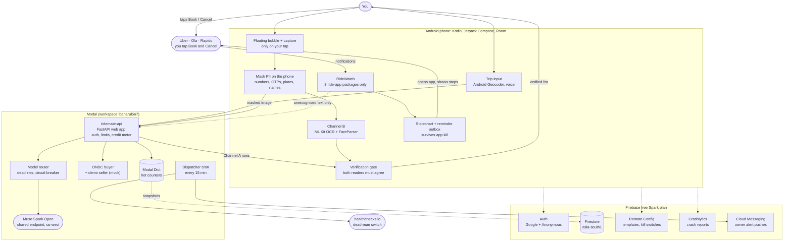

# RideMate

**Compare Rapido, Uber and Ola fares in one list, book where you like, and never pay a penalty for a booking you
forgot to cancel.**

**Built with Muse Spark Open** · Android 10+ · MIT licence · made in Barpeta, Assam by Baharul Islam for the
Meta Global AI Developer Hackathon (Indie track, theme "Build for Your World").

<!-- RELEASE_INFO -->

---

## Contents

- [What RideMate does](#what-ridemate-does)
- [The hard rule](#the-hard-rule)
- [How it works](#how-it-works)
- [Architecture](#architecture)
- [How RideMate uses Meta's models](#how-ridemate-uses-metas-models)
- [What was built during the hackathon](#what-was-built-during-the-hackathon)
- [Try the demo (for judges)](#try-the-demo-for-judges)
- [Install the signed app](#install-the-signed-app)
- [Build from source](#build-from-source)
- [Deploy the backend](#deploy-the-backend)
- [Testing](#testing)
- [Cost and money safety](#cost-and-money-safety)
- [Privacy](#privacy)
- [Permissions and why each one is needed](#permissions-and-why-each-one-is-needed)
- [Auditing the manifest](#auditing-the-manifest)
- [Project layout](#project-layout)
- [Operations docs](#operations-docs)
- [License](#license)
- [Acknowledgements](#acknowledgements)

---

## What RideMate does

Booking a ride in an Indian city often means opening Rapido, Uber and Ola one after another, typing the same
destination three times, remembering three prices, booking in two apps "just in case", and then forgetting to cancel
one of them and paying a cancellation fee. RideMate takes that juggling away.

1. **Enter your trip once.** Type your destination with address suggestions, or say it aloud (Hindi, English,
   Bengali, Assamese and other languages your phone's voice typing supports). Pickup is where you are. You confirm the
   address before anything happens.
2. **Pick apps and vehicle types.** Choose which installed ride apps (Uber, Ola, Rapido) and which vehicle types (bike,
   auto, cab) to compare, and optionally the government's open ride network, ONDC.
3. **Open each app with the route ready.** Uber opens with pickup and drop filled in. Ola and Rapido open with your drop
   address ready to paste with one tap.
4. **Read prices with one tap.** On each app's price screen you tap RideMate's small floating button. It reads the
   screen into one list, such as `Auto: Ola ₹100 · Rapido ₹110 · Uber ₹120`, with the cheapest verified option marked.
5. **Never a wrong price.** Every price is checked by two independent readers. If they don't agree, the row says
   "Couldn't read · check in app" with no number at all.
6. **You book yourself.** You tap Book inside the apps you want.
7. **RideWatch guards your bookings.** RideMate watches only those three apps' notifications. The moment a driver
   accepts, it shows how far away the driver is and asks **"Cancel the others?"**
8. **Guided cancel with proof.** On Yes, it opens each other app, shows exactly where to tap Cancel, checks that each
   cancel really happened, and keeps reminding you until every extra booking is gone.
9. **Better ride, only with your Yes.** If you chose to keep searching and a much closer driver appears, it shows both
   drivers' distance and time and switches nothing unless you say Yes.
10. **Pay in the original app.** When the ride ends, RideMate opens that ride app so you pay there. RideMate never
    handles money.

It works in English and Hindi, shows times in Indian time, and reads Indian price formats such as `₹1,234`,
`Rs 1234`, `₹110–130`, `1,23,456` and Devanagari digits.

## The hard rule

> **RideMate never taps, types, scrolls or acts inside Uber, Ola or Rapido. You tap Book. You tap Cancel.**

- No AccessibilityService, no input injection, no shell or ADB privileges, no hidden or virtual displays of other
  apps, no private APIs, no automated fare scraping.
- RideMate only looks at your screen **when you tap its button**, and Android asks your permission for each
  comparison.
- The build and the tests never script or automate those apps either. Real-app behaviour is recorded by the owner on
  his own phone with the in-app Recorder.
- Every book, cancel and switch is linked to a tap you made (invariant I1 in [architecture.md](architecture.md)).

This keeps RideMate within the ride apps' terms, Meta's Acceptable Use Policy (human confirmation for consequential
actions) and the hackathon rules.

## How it works

### Two independent readers must agree

When you tap **Read fares**, RideMate grabs two frames of your screen 400 ms apart and blurs phone numbers, OTPs, number
plates, names and the status bar **on the phone**. Then two readers work separately:

- **Channel A: Muse Spark Open** (Meta's open-weights model, running on Modal) reads the masked image into a strict,
  typed list of rows: vehicle class, label, payable price, struck-out price, pickup ETA and the row's position.
- **Channel B: ML Kit + FareParser** (Google's on-device text recognition plus RideMate's own per-app rules) reads the
  same frames on the phone.

A price is shown as **VERIFIED** only if the app matches, Channel A's digits equal the parser's payable token inside
Channel A's box, the vehicle labels match, the digits are the same in both frames, and the value passes sanity bands
(₹15–₹5,000, a ₹/km range for the trip distance). Crossed-out "old" prices are ignored. If anything disagrees,
RideMate re-reads only the disagreeing rows once (if time allows), and otherwise shows **"Couldn't read · check in
app"** with no number. Only verified rows can be marked cheapest. Every price says when it was seen and greys out after
60 seconds with a one-tap refresh.

### RideWatch: the guardian

RideWatch is a notification listener that accepts posts from exactly three packages (`com.ubercab`,
`com.olacabs.customer`, `com.rapido.passenger`). Everything else is dropped unread. Each post is masked and matched
against per-app templates (RE2/J, linear-time regex) delivered by Remote Config. A matched post becomes a ride event
in a per-app statechart (searching → assigned → arriving → on trip → ended, plus driver-cancelled, search-expired and
provider-cancelled). If a post is hidden by Android or worded in a way RideMate doesn't recognise, it never stays
silent: it asks you a simple question, for example *"Rapido has an update. Got a driver?"*

### The cancel chain, with proof and reminders

When the first driver accepts, RideMate shows the driver's distance and ETA (or "see in Rapido" if it can't confirm
them) and whether cancelling your other bookings is likely to cost anything. If two drivers accept within 10 seconds,
you pick; it never picks for you. On **Yes**:

1. It opens each other app in turn, searching bookings first because those are usually free to cancel.
2. It shows that app's exact steps ("Tap **Cancel** → **Booked another ride** → **Confirm**") and, if you ask,
   an arrow drawn **beside** the Cancel button (never covering it, and it can't be tapped through).
3. You tap Cancel yourself.
4. It counts the booking as cancelled only on **proof**: the app's own "cancelled" notification, or the ride
   notification disappearing together with a cancelled screen. If you say "I cancelled it", it checks again a minute
   later and warns loudly if the ride still looks active.
5. Until every extra booking is proven cancelled, ended by the app, or dismissed by you, it reminds you after 30 s,
   1 min and 2 min, then every 2 min, even if you close RideMate.

It also handles the ride apps' own changes: a driver cancelling on you, a new driver being assigned, a search
expiring, or the same driver showing up on two apps ("Same driver on both. Keep one.").

### Better ride, only on Yes

"Keep searching" is off by default and comes with a fair-play warning. When it's on and a later driver would reach you
at least 5 minutes sooner **and** at least 40% sooner (verified ETAs only), RideMate shows both drivers' distance and
time and any fee. Yes guides you to cancel the old
booking; No guides you to cancel the new one. Nothing changes without a tap.

### ONDC: the open ride network (demo seller during the hackathon)

On ONDC, RideMate can search, book and cancel entirely inside itself, always after your tap, through the official
TRV10 mobility protocol (signed requests, callbacks stored before acknowledging). Any cancellation fee is shown before
you confirm. **During the hackathon this runs against an in-process mock seller clearly labelled "ONDC demo seller".**
No real ONDC ride is booked. At public launch ONDC is switched off until production onboarding.

### Manual mode: it always works

If the AI is slow, down, switched off, or its budget is used up, or you're offline or not signed in, RideMate lets you
type the price you see (labelled "entered by you"). The guardian and the cancel reminders run entirely on the phone and
keep working. Every step has a time limit, so nothing hangs. When AI reading is paused you see *"AI reading resumes at
hh:mm (IST)"*.

## Architecture



The full design, with the statechart transition table, invariants I1–I10, data model and alternatives that were
rejected, is in [architecture.md](architecture.md). The exact API and config contracts are in
[docs/contracts.md](docs/contracts.md).

## How RideMate uses Meta's models

All AI work runs on **Muse Spark Open**, Meta's open-weights model (`meta-models/Muse-Spark-Open-816B-A42B`), on
**Modal's shared endpoint** (region us-west, USA), paid only from the $100 Modal hackathon credit. The model id is
pinned and checked at startup; changing it must pass the evaluation harness first.

| Task | How Muse Spark Open is used | If it isn't available |
|---|---|---|
| **Fare and status reading** (Channel A) | Reads the masked screenshot alone (no OCR text in the prompt) into a strict schema: screen type, up to 12 rows of vehicle class, label, payable price, struck price, ETA and box, plus driver ETA and distance. Low reasoning, ≤ 800 output tokens. | One retry within the 20 s tap budget, then "Couldn't read · check in app" or manual entry. The gate applies either way. |
| **Re-reading disagreeing rows** | One call with just the crops of the rows the two readers disagreed on. | The row stays "Couldn't read". |
| **"Show me" pointing** | Grounding: finds the Cancel button's box (0–1000 grid) so an arrow can be drawn beside it, if the day-1 check showed grounding is supported. | The Show me button hides. |
| **Notification understanding** | For ride-app notifications no template recognises (a "rule miss"), classifies the masked text into searching / assigned / arriving / cancelled / … and must quote an `evidence_span` that really appears in the text. A label can only raise a question to you or move a ride forward; it can never mark a booking cancelled or end it. | RideMate asks you directly ("Rapido has an update. Got a driver?"). |
| **Voice destination** | Android's own speech recognizer turns your voice into text on the phone; Muse Spark Open picks which of up to 5 Android Geocoder candidates you meant (or `none`). | You pick from the list or type. |
| **Place pick** (typed) | Same enum pick over Geocoder candidates. | You pick from the list. Addresses are always confirmed by you. |
| **Template Doctor** (owner tool, offline) | An agent that reads the owner's masked recordings after a ride app changes, proposes regex and parser fixes, and runs the regression suite. Output is a pull request that the owner approves; it never sees user data. | Templates are fixed by hand. |

On-device OCR (Channel B) is Google ML Kit, **deliberately not a Meta model**, so the two readers are independent.

**Why open weights on Modal?**

- **Zero out of pocket.** Meta's hosted Model API has no free tier. Muse Spark Open on Modal runs entirely on the
  hackathon's Modal credit, which is the owner's only funding.
- **One place for all spend.** The model and RideMate's own server live in the same Modal workspace, so a single
  meter and a single spend limit cover every rupee.
- **Open weights, verifiable model.** The model id is pinned and confirmed with `GET /v1/models`; Modal verifies the
  model for the Best Build on Meta Open Weight Models award.
- **No lock-in.** A generic router (`model_route` in Remote Config) can add another provider later without code
  changes.

Not used: any paid Meta Model API model, and any computer-use or agent tool that acts in other apps (RideMate never
acts, by design).

> **Built with Muse Spark Open.** As the Muse Spark Open licence requires, the app shows this label in Settings and
> onboarding has an 18+ gate.

## What was built during the hackathon

**Everything in this repository was written during the Meta Global AI Developer Hackathon build window
(Oct 27 – Nov 4, 2026). All code in this repo was written from Oct 28, 2026**, and the commit history is dated. The
design documents (`goal.md`, `architecture.md`, `setup.md`) were written and approved at the start of the event. No
code existed before. Third-party libraries are used through Gradle and `uv` with locked versions.

Parts built during the event:

- **Android app** (`android/`), Kotlin + Jetpack Compose, package `in.ridemate.app`:
  - `core` module (pure Kotlin, JVM-tested): Indian number and time formats, PII masking, OCR token model, FareParser
    (Channel B), VerificationGate, config loaders with schema checks, RideWatch pipeline and RE2/J template engine,
    ride statechart (exact transition table), Guardian (first-driver sheet, cancel chain, evidence ladder, reminders,
    better-ride rule), invariant checkers I1–I10.
  - `app` module: onboarding (18+, privacy notice, Google sign-in, permissions), trip input, app launcher, floating
    bubble and pointer overlay, MediaProjection capture, ML Kit OCR, RideWatch notification listener, foreground
    ride session service, Room database with tested migrations, Try the demo, ONDC client, Settings (My data, Erase,
    kill-switch status, update check, signing fingerprint), developer-mode Recorder.
- **Backend** (`backend/`): the `ridemate-api` FastAPI app on Modal: Firebase token auth, per-IP and per-user limits,
  the all-spend credit meter with daily pacing, the model gateway and router for Muse Spark Open, demo-image cache,
  ONDC buyer with Ed25519 signing plus the in-process demo seller, the 15-minute dispatcher cron (alerts, snapshots,
  probes, cleanup, billing reconciliation), and `deploy.sh`.
- **Config** (`config/`): Remote Config template, JSON schemas, bundled defaults for templates, parsers, cancel cards,
  fee rules, sanity bands and kill switches.
- **Firebase** (`firebase/`): deny-by-default Firestore rules, indexes and rules tests.
- **Evaluation** (`eval/`): accuracy harness, recorded model outputs, synthetic and replay fixtures, adversarial and
  prompt-injection suites. (The labelled real screens live in the private repo `Baharul0111/ridemate-golden`, never
  here.)
- **Template Doctor** (`tools/template_doctor/`).
- **CI** (`.github/workflows/`): unit, replay and migration tests, CodeQL, Android Lint, bandit, dependency checks.
- **Docs** (`docs/`): contracts, runbooks, incident plan, launch checklist, privacy notice (English and Hindi), SLOs and
  alerts, secrets inventory, demo video script.

## Try the demo (for judges)

You don't need Uber, Ola or Rapido, an Indian phone number, a sign-in, or any AI budget.

1. Install the signed APK from GitHub Releases (see [Install the signed app](#install-the-signed-app)) on any phone
   with Android 10 or newer.
2. Open RideMate, confirm you're 18 or older, read the short privacy notice, and choose **Skip sign-in** if you like.
3. Tap **Try the demo** (it's also offered automatically when no supported ride app is installed).
4. The demo uses made-up screens from three **fictional** ride companies, **Kestrel Go**, **Pepper Rides** and
   **Tamarind Cabs**, all labelled DEMO. It runs the real pipeline: ML Kit on your phone plus Muse Spark Open on Modal,
   through the same verification gate. Watch for:
   - the comparison list with the cheapest verified option marked (and a "Couldn't read · check in app" row if the
     readers disagree on something);
   - a driver being found → **"Cancel the others?"** → the guided cancel with proof and reminders;
   - a better-ride offer that changes nothing until you tap Yes;
   - the pay handoff at the end;
   - the ONDC demo seller (search, book, a fee shown before a cancel).
5. Demo reads are served from a cache keyed by image hash (costing credit only on a cache miss). If AI is paused or
   capped, the demo falls back to recorded Muse Spark Open outputs, clearly marked "recorded". The demo never mixes
   with real bookings.

More for judges: [docs/hackathon.md](docs/hackathon.md) and the 3-minute
[demo video script](docs/demo-video-script.md).

## Install the signed app

RideMate is installed directly from GitHub Releases (sideloaded), not from the Play Store.

1. Go to <https://github.com/Baharul0111/ridemate/releases/latest> and download the APK
   (for example `RideMate-1.0.0-hackathon.apk`) and `SHA256SUMS.txt`.
2. **Check the file wasn't changed in transit.** The printed hash must equal the one in `SHA256SUMS.txt` and in the
   release notes:

   ```bash
   # Linux
   sha256sum RideMate-1.0.0-hackathon.apk
   sha256sum -c SHA256SUMS.txt

   # macOS
   shasum -a 256 RideMate-1.0.0-hackathon.apk
   shasum -a 256 -c SHA256SUMS.txt
   ```

   ```bat
   :: Windows (Command Prompt or PowerShell)
   certutil -hashfile RideMate-1.0.0-hackathon.apk SHA256
   ```

3. **Check it was signed by RideMate's release key.** `apksigner` comes with the Android SDK build-tools
   (`$ANDROID_HOME/build-tools/<version>/apksigner`, or `apksigner.bat` on Windows):

   ```bash
   apksigner verify --verbose --print-certs RideMate-1.0.0-hackathon.apk
   ```

   The output must say `Verified using v2 scheme (APK Signature Scheme v2): true` (or v3) and show:

   ```text
   Signer #1 certificate SHA-256 digest: 94f2dd5fdb02aded4631cb0a094a0bee810532c1c8ae2223c17d1c7aa4227aa0
   ```

   which is the same fingerprint written with colons:

   ```text
   94:F2:DD:5F:DB:02:AD:ED:46:31:CB:0A:09:4A:0B:EE:81:05:32:C1:C8:AE:22:23:C1:7D:1C:7A:A4:22:7A:A0
   ```

   The app shows the same fingerprint in **Settings → About**. If it is different, **do not install it**, and please
   report it (see [SECURITY.md](SECURITY.md)).
4. Install: open the APK on the phone and allow your browser or Files app to "install unknown apps" when Android asks,
   or from a computer run `adb install RideMate-1.0.0-hackathon.apk`.
5. On Android 13 and newer, sideloaded apps need one extra step before notification access can be turned on:
   **Settings → Apps → RideMate → ⋮ → Allow restricted settings**. RideMate's onboarding walks you through it.

RideMate tells you in the app when a newer release is available (it learns about new releases through its remote
settings) and shows you where to download it.

## Build from source

Requirements: **JDK 17**, the **Android SDK** (platform 36 and current build-tools; Android Studio installs both),
and for the backend **Python 3.12** with [uv](https://docs.astral.sh/uv/).

```bash
git clone https://github.com/Baharul0111/ridemate.git
cd ridemate/android
./gradlew :core:test :app:testDebugUnitTest   # unit, replay and migration tests
./gradlew :app:assembleDebug                  # debug APK in app/build/outputs/apk/debug/
```

`android/app/google-services.json` points at the owner's Firebase project. For your own build with your own backend,
replace it with the file from your Firebase project.

**Release build (owner only).** The release keystore lives at `~/.ridemate/release.jks` (alias `ridemate`) and never
enters CI. With `RIDEMATE_KEYSTORE_PASSWORD` set in the environment:

```bash
cd android
./gradlew :app:assembleRelease
apksigner verify --print-certs app/build/outputs/apk/release/app-release.apk   # must show the fingerprint above
cp app/build/outputs/apk/release/app-release.apk RideMate-<version>.apk          # the name users will download
shasum -a 256 RideMate-<version>.apk > SHA256SUMS.txt   # lists that file name, so "shasum -c" works for users
```

Without the keystore, Gradle produces an unsigned release APK. Publishing a release to GitHub waits for Baharul's
explicit go-ahead.

## Deploy the backend

The backend is the FastAPI web app **`ridemate-api`** in the Modal workspace **`ibaharul567`**. All function settings
(containers, concurrency, timeouts, secrets, the single dispatcher cron) live in code in `backend/modal_app.py`.

```bash
cd ridemate
set -a; . ./.env; set +a        # load your values into this terminal only; never print them
./backend/deploy.sh             # see the comments at the top of the script for its options
```

`deploy.sh`:

1. creates or updates the Modal Secrets (`ridemate-model`, `ridemate-core`, `ridemate-web-sa`, `ridemate-ops-sa`,
   `ridemate-alerts`) from the environment,
2. runs `modal deploy` for `ridemate-api` (the `main` environment for production, `dev` for testing),
3. deploys `firebase.json`, the Firestore rules and indexes, and the Remote Config template with the Firebase CLI
   (the `ridemate-dev` Firebase project for testing).

Then check it's alive: `curl -fsS https://<url printed by modal deploy>/readyz`. Rolling back means redeploying the
last good git tag ([docs/runbooks/rollback.md](docs/runbooks/rollback.md)).

## Testing

| Suite | What it covers | Command |
|---|---|---|
| Core unit tests | Price checker (VerificationGate), Indian number formats, masking, FareParser, sanity bands, invariants I1–I10, prompt-injection text in screens and notifications, timeouts, limits and caps | `cd android && ./gradlew :core:test` |
| Replay tests | Every ride-state change from recorded notification sequences, including drivers cancelling and re-matching, redacted posts, the "never silent" (I9) and "always reminds" (I8) promises | part of `:core:test` |
| App unit + migration tests | Room database upgrades with `MigrationTestHelper` (no destructive fallback), app wiring | `./gradlew :app:testDebugUnitTest` (and `:app:connectedDebugAndroidTest` on a connected phone) |
| Backend tests | Auth, per-IP and per-user limits, spend meter and pacing, router deadlines and breaker, body limits, ONDC signing and ownership, erase | `cd backend && uv sync && uv run pytest` |
| Firestore rules tests | Deny by default, no client writes, owner-only ONDC reads | in `firebase/`, run against the Firestore emulator: `firebase emulators:exec --only firestore --project demo-ridemate "<test command in firebase/package.json>"` |
| Accuracy test | Runs the full two-reader check on labelled sample screens using **recorded** Muse Spark Open outputs and recorded ML Kit tokens. **No AI spend, no network.** | `./gradlew :core:test --tests '*Accuracy*'` and the harness in `eval/` in recorded mode |
| Static checks | CodeQL (Kotlin, Python), Android Lint security, bandit, ruff, dependency verification | GitHub Actions |

Public CI never touches the private golden set and never prints fare values.

<!-- TEST_RESULTS -->

## Cost and money safety

**Baharul pays nothing out of his own pocket.** The only money RideMate ever spends is the **$100 Modal hackathon
credit**. Everything else is free with no card on file.

- **What costs money:** only Modal (Muse Spark Open tokens, and CPU/memory for `ridemate-api`).
  Free, with no card: Firebase Spark plan (Auth, Firestore, Remote Config, Crashlytics, FCM), Android Geocoder and
  speech recognizer, ML Kit, GitHub, healthchecks.io.
- **Budget split of the credit:** AI **$80** · compute **$12** · margin **$8**, with sub-budgets for app traffic,
  judging, evals and Template Doctor (≤ $5 total, ≤ $0.50 per run), demo cache misses and probes.
- **Modal's own spend limit** is set to $0 (or the lowest Modal allows), so at the limit Modal stops the app instead of
  charging a card. Modal requires a card on file; this limit is what keeps it from ever being charged. The public link
  waits for Modal billing's written confirmation.
- **All-spend meter.** Every model call (app, demo, evals, Template Doctor, probes) and every container's uptime goes
  through one meter. The maximum possible cost of a call is **reserved before** the call and settled with the real
  token count after. If the meter can't be read, AI **fails closed**.
- **Daily pacing.** Daily cap = remaining AI budget ÷ days left × 1.5. The credit's expiry date is unknown, so the
  horizon is **90 days from 2026-10-28** (to 2027-01-26), which makes the first day's cap about $1.33. At 70% of the
  day's cap, new and heavy accounts pause; at 100% of the day's cap or any budget, AI pauses for everyone.
- **Fair share per person:** 6 screen reads + 10 notification parses a day (about 1–2 ride sessions); accounts younger
  than 24 hours get 3 reads; a judge allowlist gets 20. AI needs Google sign-in; anonymous users never reach anything
  that costs money.
- **Daily reconciliation** against Modal's billing report: a drift above 10% alerts the owner and tightens caps
  automatically.
- **Manual mode** is the safety net: when AI pauses, you type the price and the guardian keeps working, free.

At roughly $0.02–0.03 of credit per ride session, the AI budget covers about 2,500–3,500 sessions in total, paced to
about 80–110 a day. The owner can see the remaining budget in developer mode.

## Privacy

Short version (full notice: [English](docs/privacy-notice.md) · [हिन्दी](docs/privacy-notice-hi.md)):

- RideMate is for adults (18+).
- Phone numbers, OTPs, number plates and names are blurred **on your phone** before anything leaves it.
- Screenshots are never stored. **AI processing happens on Modal's cloud servers in the USA.**
- RideMate reads notifications from Uber, Ola and Rapido only; all others are dropped unread.
- Ride data on your phone is deleted a day after the ride.
- **Settings → My data** shows what RideMate holds. **Settings → Erase:** "Erase deletes your account, your RideMate
  data on this phone and on our server, except metadata logs (1 year, required by law) and an anonymous usage counter
  (48 h, abuse prevention)."
- No ads and no advertising ID; Firebase Analytics is switched off.
- Privacy and grievance contact: **ibaharul567@gmail.com** (reply within 30 days).

## Permissions and why each one is needed

| Permission / access | Why RideMate needs it | When it's used |
|---|---|---|
| Notification access (notification listener) | RideWatch: notice a driver accepting, cancelling or arriving in Uber, Ola or Rapido. Posts from every other app are dropped unread. | While you have an active booking |
| Display over other apps (`SYSTEM_ALERT_WINDOW`) | The floating RideMate button on the ride app's screen, and the "Show me" arrow drawn beside (never over) the Cancel button | During a comparison or cancel |
| Screen capture (MediaProjection consent) | Read the fare screen **when you tap** the button. Android asks each comparison; capture stops right after the last fare is read | Only after your tap |
| `FOREGROUND_SERVICE`, `FOREGROUND_SERVICE_SPECIAL_USE` | Keep the ride guardian and reminders alive until every extra booking is proven cancelled | During a ride session |
| `FOREGROUND_SERVICE_MEDIA_PROJECTION` | Android requires it while screen capture is running | Between your consent and the last fare read |
| `POST_NOTIFICATIONS` | "Driver found", "Cancel the others?", reminders and the ongoing session notification | During a ride session |
| Location (`ACCESS_COARSE_LOCATION`, `ACCESS_FINE_LOCATION`, while in use) | Pickup defaults to where you are; trip distance for the price sanity check | When you start a trip |
| Microphone (`RECORD_AUDIO`) | Say your destination aloud through Android's speech recognizer | Only when you tap the mic |
| `REQUEST_IGNORE_BATTERY_OPTIMIZATIONS` | Stop Android's battery saver from killing reminders | You approve it once |
| `RECEIVE_BOOT_COMPLETED` | Re-arm pending cancel reminders after the phone restarts | After a restart, if reminders are pending |
| `WAKE_LOCK` | Keep the phone's processor awake so cancel reminders and the one-minute check fire with the screen off (no exact alarms are used) | Only while an extra booking still needs cancelling |
| `VIBRATE` | Loud alerts, for example "your ride is still active" | Alerts only |
| `INTERNET`, `ACCESS_NETWORK_STATE` | Talk to RideMate's server and Firebase; detect offline and switch to manual mode | Normal use |

Package visibility (`<queries>`) is limited to the three ride apps plus the map (`geo:`), web link and speech
recognizer intents.

## Auditing the manifest

You can check for yourself that RideMate cannot act inside other apps. There is **no AccessibilityService, no input
injection, no shell, no hidden displays**:

- no `<service>` with `android.permission.BIND_ACCESSIBILITY_SERVICE` or an `accessibilityservice` intent filter;
- no `INJECT_EVENTS`, `WRITE_SECURE_SETTINGS` or other signature/system permissions, and no Shizuku or ADB integration;
- the only display RideMate creates is the MediaProjection capture of **your own screen**, started by your tap with
  Android's consent dialog and its visible capture indicator; no hidden or virtual displays of other apps;
- `android:allowBackup="false"`, release builds are not debuggable, R8 is on.

```bash
# Using the Android SDK command-line tools on the downloaded APK
apkanalyzer manifest permissions RideMate-1.0.0-hackathon.apk
apkanalyzer manifest debuggable RideMate-1.0.0-hackathon.apk          # must print: false
apkanalyzer manifest print RideMate-1.0.0-hackathon.apk \
  | grep -i -E 'accessibility|INJECT_EVENTS|WRITE_SECURE_SETTINGS|shizuku' \
  || echo "OK: no accessibility service, no input injection"
```

`apkanalyzer manifest permissions` lists the final (merged) manifest, so you will also see a few standard permissions
added by Google's and Android's own libraries (RideMate itself also declares `WAKE_LOCK`, see the table above), for
example `WAKE_LOCK` (WorkManager, Firebase Cloud Messaging),
`com.google.android.c2dm.permission.RECEIVE` (Firebase Cloud Messaging) and
`in.ridemate.app.DYNAMIC_RECEIVER_NOT_EXPORTED_PERMISSION` (AndroidX). None of them lets RideMate act inside another
app.

The source manifest is [android/app/src/main/AndroidManifest.xml](android/app/src/main/AndroidManifest.xml). A MobSF
scan runs before any public link.

## Project layout

```text
ridemate/
├── android/                 Android app (Gradle, version catalog)
│   ├── core/                pure-Kotlin logic: formats, masking, FareParser, gate, RideWatch, statechart, guardian
│   └── app/                 Android app in.ridemate.app: UI, capture, OCR, listener, services, Room, demo, ONDC client
├── backend/                 ridemate-api: FastAPI on Modal
│   ├── ridemate_api/        auth, limits, spend meter, model gateway + router, ONDC buyer + demo seller, cron
│   ├── tests/               pytest suite
│   ├── modal_app.py         Modal image, secrets, web app, dispatcher cron
│   └── deploy.sh            one-command deploy (Modal + Firebase)
├── config/                  Remote Config template, JSON schemas, bundled defaults
├── firebase/                firebase.json, Firestore rules + indexes, rules tests
├── eval/                    accuracy harness, recorded outputs, synthetic + replay fixtures (no private data)
├── tools/template_doctor/   owner tool that proposes template fixes (human-approved)
├── docs/                    contracts, runbooks, incident plan, LAUNCH checklist, privacy notices, SLOs, demo script
├── architecture.md          the authoritative design
├── goal.md                  what "done" means
├── setup.md                 the owner's one-time setup
├── SECURITY.md              how to report security problems
└── LICENSE                  MIT
```

## Operations docs

- Runbooks: [docs/runbooks/](docs/runbooks/README.md) (ride-app update breaks reading, Modal down or credit used up,
  cap tripped or abuse, platform objection, leaked key or keystore, ONDC callbacks failing, model removed, manual
  erasure, rollback, key rotation, judging week, public launch, restore golden set)
- [Incident plan](docs/incident-plan.md) · [Launch checklist](docs/LAUNCH.md) ·
  [SLOs and alerts](docs/slo-and-alerts.md) · [Secrets inventory](docs/secrets-inventory.md) ·
  [Hackathon notes](docs/hackathon.md) · [Demo video script](docs/demo-video-script.md)

## License

[MIT](LICENSE), Copyright (c) 2026 Baharul Islam.

The model is used under the Muse Spark Open licence ("Built with Muse Spark Open", 18+). Uber, Ola and Rapido are
trademarks of their owners. RideMate is not affiliated with them. Kestrel Go, Pepper Rides and Tamarind Cabs are
fictional companies made up for the demo.

## Acknowledgements

- **Meta** for the Muse Spark Open open-weights model, and **Modal** for hosting it and RideMate's server.
- **Google ML Kit** Text Recognition v2 (on-device OCR, Latin and Devanagari) and **Firebase**.
- **Noto Sans** (Latin) and **Mukta** (Devanagari) fonts, used under the SIL Open Font License 1.1 (OFL) to draw the
  fictional demo screens and the synthetic test screens (licence files in `eval/fonts/`).
- The **ONDC TRV10 mobility specification** ([ONDC-Official/mobility-specification](https://github.com/ONDC-Official/mobility-specification));
  the demo seller replays its example payloads, fetched at build time and not committed.
- RE2/J, FastAPI, PyNaCl, `cryptography`, the `openai` Python SDK, and the Android Jetpack libraries.
