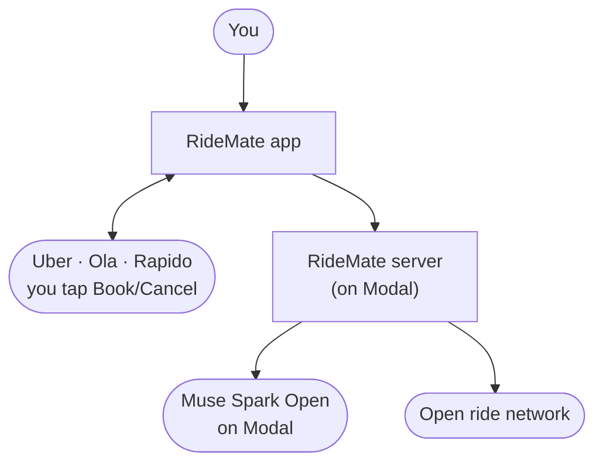
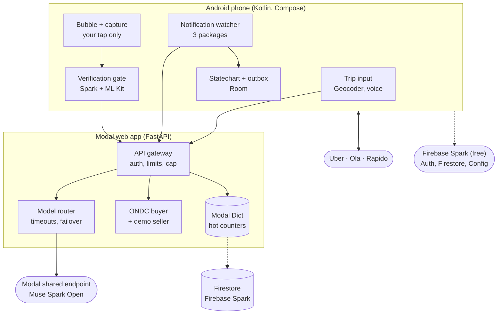
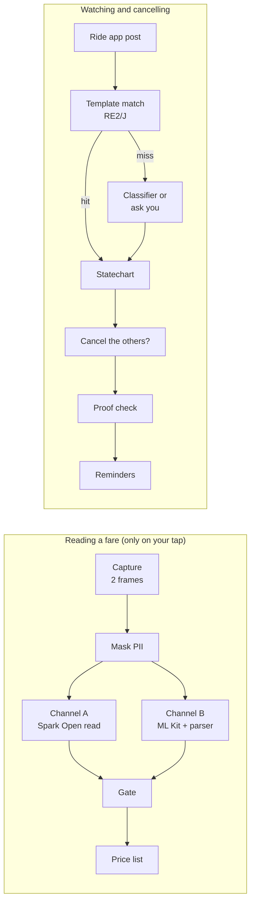
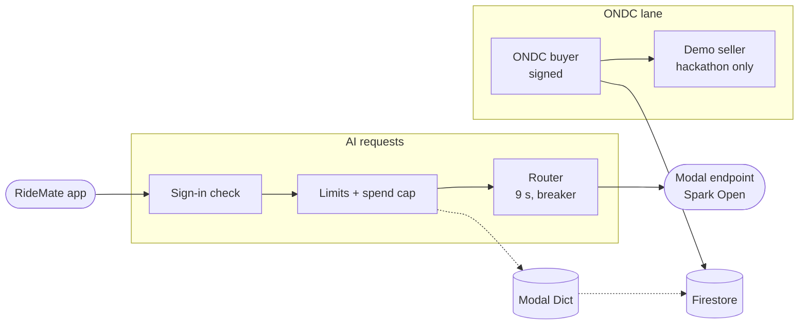
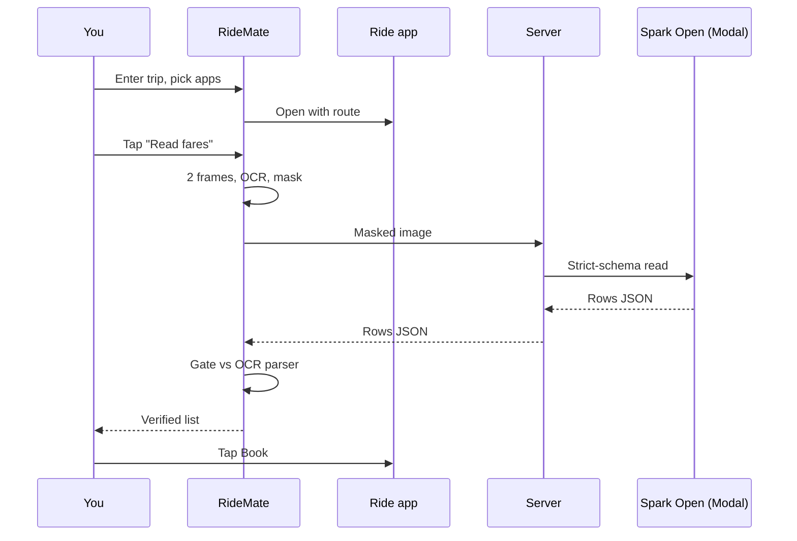
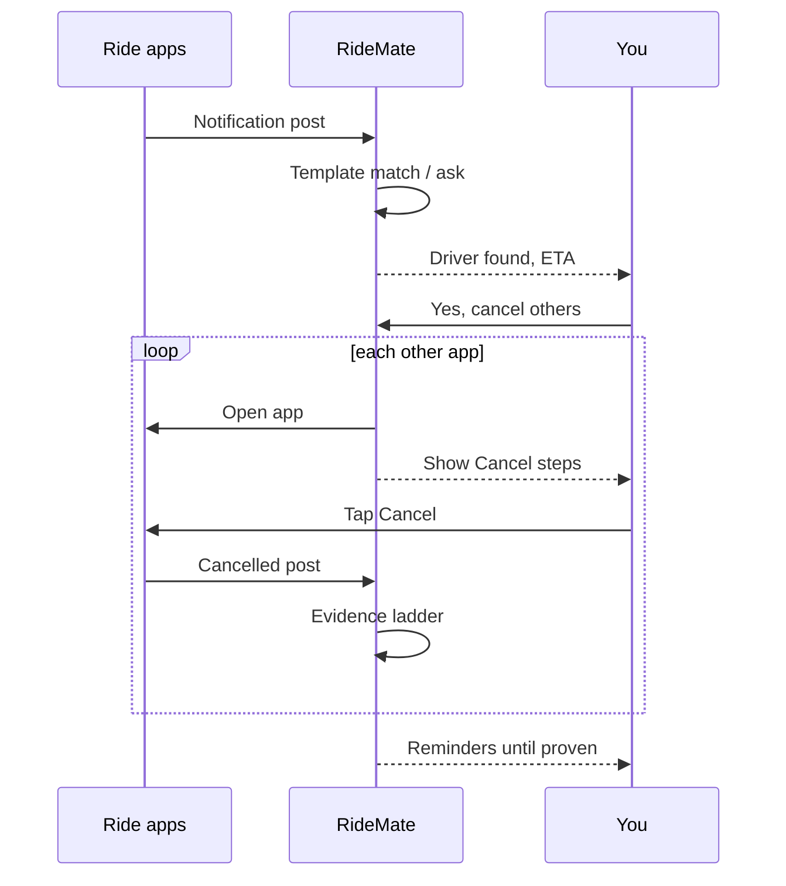
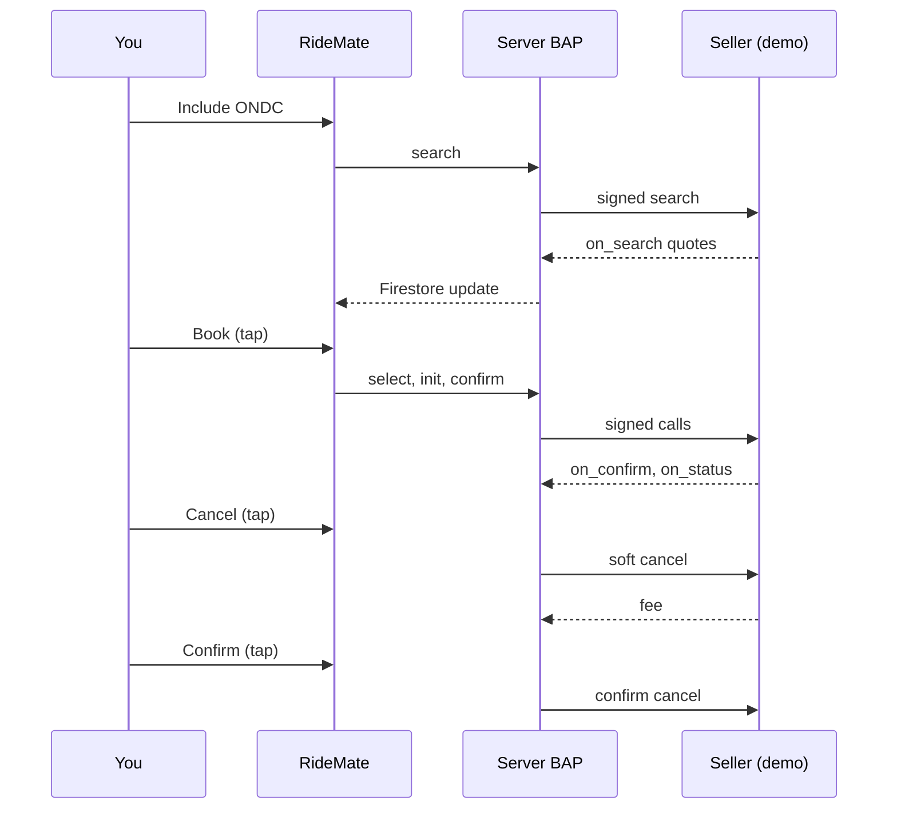

# RideMate — Architecture
> Approved by Baharul Islam on 27 Oct 2026; **revised 28 Oct 2026 for a zero out-of-pocket budget** (Modal credit only). Built by the Fuller pipeline (5 research lanes, 5 competing designs, cross-examination, Chief Architect verdict, 3-round production gate). Do not deviate without updating this file. Section numbers like §4.5 refer to the subsections of "4. Design" below.

## 1. What this system is
RideMate is a phone app that takes the juggling out of booking rides on Rapido, Uber and Ola.

- **Before booking:** you type or say where you're going once, and RideMate opens each ride app you picked with the route filled in. On each app's price screen you tap RideMate's small floating button, and it reads the prices into one clean list ("Auto: Ola ₹100 · Rapido ₹110 · Uber ₹120"). It double-checks every number, so it never shows you a wrong price.
- **Booking:** you tap Book yourself in the apps you want.
- **After booking:** RideMate watches those apps' notifications. When a driver accepts in one, it shows how far away the driver is and asks "Cancel the others?" If you say yes, it opens each other app straight away, shows exactly where to tap Cancel, and keeps checking and reminding until every extra booking is proven cancelled. No forgotten booking, no surprise penalty.
- **Better ride:** if you chose to keep looking and a closer driver turns up, it tells you the distance and time, and switches only if you say yes.
- **ONDC rides:** on the government's open ride network (ONDC), RideMate can search, book and cancel completely inside itself.
- **Payment:** at drop, it opens the ride app so you pay there.

## 2. Requirements & constraints
- **Product owner:** Baharul Islam (Barpeta, Assam). Built for the **Meta Global AI Developer Hackathon**: Indie track, theme "Build for Your World", solo.
  - Build window Oct 27 – Nov 4 2026; submission due **Nov 5, 07:30 IST**.
  - Public GitHub repo; **only code written during the event**; a 3-minute demo video; a live product.
  - Judged on Impact, Use of Meta AI tooling, Technical depth and Demo, equally weighted.
  - Projects violating legal, ethical or platform policies are disqualified.
- **HARD RULE: RideMate never taps, types, scrolls or otherwise acts inside Rapido, Uber or Ola.** No AccessibilityService actions on them, no hidden or virtual displays of other apps, no shell/ADB privileges, no reverse-engineered private APIs, no automated fare scraping. The user does every Book and Cancel tap in those apps. *The build itself must never script, drive or automate those apps either, including for testing.* Real-app behaviour is recorded by the owner with the in-app Recorder (§4.19).
- **Users:** real public users later. Engineering is sized for ~100–1,000 users and ≤ 50 concurrent sessions, but **AI capacity is bounded by the credit: ≈ 2,500–3,500 AI sessions in total, paced to ≈ 80–110 per day**. Beyond that, users are in manual mode (guardian still free) until more credit is funded. The 10× path is documented.
- **Production-grade, small scale.** Android only, minSdk 29 (Android 10), non-rooted, APK installed directly (sideloaded) at first.
- **ZERO OUT-OF-POCKET (owner's hard rule, 28 Oct 2026):** the owner's only funding is the **$100 Modal credit** (workspace `ibaharul567`). Anything that costs money must run on Modal and be paid from that credit. Anything else must be genuinely free with **no card on file**. So: **no Meta Model API** (it has no free tier), no Baseten, no Google Cloud billing (no Cloud Run, Places or Cloud Storage), and Firebase on the free **Spark** plan. **Modal requires a payment method on file** (its billing docs), so the guarantee is: (1) a **workspace spend limit set to $0 or the lowest Modal allows**, so Modal stops workloads instead of charging beyond the credit; (2) RideMate's own **all-spend meter** (§4.2), which pauses AI well before the credit runs out; (3) a written confirmation from billing@modal.com before the public link. Meta's models are used as **Muse Spark Open (open weights) on Modal's shared endpoint**, which the hackathon rules accept ("Meta Model API and/or Meta's open-weight models") and which targets the Best Open Weight award.
- **Budget:** $0 out of pocket. AI spend is hard-capped below the Modal credit (§4.2 spend control). Every price, ETA and booking state shown must still be correct.
- **Booking behaviour:**
  - The user picks apps and vehicle types, then books in each app.
  - On the first driver, RideMate shows distance and ETA and asks "Cancel the others?". On Yes, it opens each other app, guides the cancel, verifies it, and reminds until proven.
  - Better-ride switch only on an explicit Yes.
  - Payment at drop happens in the original app.
- **Law and policy:** India's DPDP Act 2023 / DPDP Rules 2025; the Motor Vehicle Aggregator Guidelines 2025 (cancellation fee 10% capped at ₹100 "without valid reason"; state rules may differ); the Muse Spark Open license ("Built with Muse Spark Open" label; 18+ gate); Meta AUP (no autonomous agents acting against third-party terms; human confirmation for consequential actions).
- **Assumptions made for the owner (stated in the report):** Android 10+; Google sign-in required for AI features; AI pauses (manual mode) when the Modal credit budget is used up; no card is added to Google or Firebase; Modal holds a card only because it requires one, with its spend limit set to $0 / lowest so nothing beyond the credit is ever charged; sideloaded first; testing in Guwahati.

## 3. Architecture diagrams

### Level 1: the simple view

### Level 2: detailed technical architecture

### Level 3: inside the phone

### Level 3: inside the server

### Data flow: compare and book (sequence)

### Data flow: guardian and cancel (sequence)

### Data flow: ONDC (sequence)

## 4. Design (authoritative)

### 4.1 Shape
RideMate is a Kotlin/Jetpack Compose Android app (minSdk 29, targetSdk 35) that does almost all of its work on the phone, plus one small stateless Python 3.12 FastAPI web app **hosted on Modal** (the same workspace that serves Muse Spark Open). It holds the secrets, enforces quotas and the credit budget, and hosts the ONDC buyer flow. Firebase (free Spark plan) provides sign-in, Firestore, Remote Config, Crashlytics and FCM. Nothing requires a card. The ONDC flow runs against an in-process mock seller during the hackathon.

- RideMate opens the ride apps with the route filled in.
- It reads a fare screen only when the user taps its floating bubble.
- It watches the three ride apps' notifications and runs one deterministic statechart per ride app (a "leg").
- When the first driver is found, it asks "Cancel the others?", opens each other app in turn, shows the exact taps, and keeps reminding until each cancel is proven.

The user makes every Book and Cancel tap inside Uber, Ola and Rapido. On the ONDC network, RideMate itself searches, books and cancels through the official protocol, always after a user tap. A clearly labelled **Try the demo** mode runs the full pipeline on bundled sample screens of fictional providers, for judges and users without Indian ride apps.

### 4.2 Components

**Android app** (Kotlin, Jetpack Compose, Room, WorkManager, OkHttp, ML Kit, Firebase SDKs, RE2/J)

| Component | What it does |
|---|---|
| Onboarding | 18+ gate → DPDP notice (§4.11 inventory) → **Sign in with Google** (scopes `openid email`; skippable to manual mode, offered again at the first Read fares) → notification permission → notification access → display over other apps → on sideloaded Android 13+/15, a guided "Allow restricted settings" step → location (while in use) → battery-optimisation exemption + OEM autostart guidance (Xiaomi, Oppo/Realme/Vivo, Samsung) → health check (a test notification is seen by RideWatch) |
| Pre-session check | At every Compare tap: listener connected (ping), overlay granted, battery exemption. If RideWatch is blind, Compare is blocked with a fix-it card. Distinct states: no supported app installed (→ offer Try the demo), offline, location denied, no fares found, no ONDC results |
| TripInput | Pickup = current location (fused location, while in use). Drop = **Android `Geocoder`** search (free, no key; async API on 33+, debounced 400 ms) plus on-device recent places, or **voice via Android `SpeechRecognizer`** (free; en-IN / hi-IN / bn-IN / as-IN where the phone supports it) → transcript → `/v1/place-pick` (Spark Open on Modal picks among ≤ 5 Geocoder candidates or `none`). The user confirms the address text; "View on map" opens a `geo:` intent in the phone's own maps app (no map tiles, no key). Then the user selects apps (installed only, via `<queries>`), vehicle types and optionally ONDC |
| AppLauncher | Uber: `https://m.uber.com/ul/?action=setPickup&pickup[latitude]=…&pickup[longitude]=…&pickup[nickname]=…&dropoff[latitude]=…&dropoff[longitude]=…&dropoff[nickname]=…`, with **no `client_id`** (day-1 test; fallback plain launch). Ola and Rapido: `getLaunchIntentForPackage` + drop address copied + a bubble "Paste drop" chip. Templates come from Remote Config. Auto-opening another app happens only while the bubble is visible (Android 15 rule); otherwise a heads-up notification whose tap opens it |
| GuardianBubble | `TYPE_APPLICATION_OVERLAY` (SYSTEM_ALERT_WINDOW), draggable, `FLAG_NOT_FOCUSABLE`, 48 dp targets, content descriptions. Actions: Read fares · Booked here · Show me · Done · Stop. Every action is mirrored on RideMate's ongoing notification (fallback when an app hides overlays) |
| PointerOverlay | Arrow drawn **beside** the target control: `FLAG_NOT_TOUCHABLE`, alpha ≤ 0.8, never covering it |
| CaptureManager | MediaProjection via `createScreenCaptureIntent(MediaProjectionConfig.createConfigForDefaultDisplay())` on API 34+ (whole screen, so no single-app mode). One consent per comparison; one VirtualDisplay + ImageReader of the user's own screen; `onStop` registered. A tap hides the bubble, grabs 2 frames 400 ms apart, shows the bubble again. **Stops right after the last fare read**. Later captures (Show me, driver ETA, cancel proof) are optional and labelled "Android will ask again". Fallback: share a screenshot to RideMate (`ACTION_SEND image/*`). Black-frame (FLAG_SECURE) detection → never bypassed → fallback |
| OcrAndMask | ML Kit Text Recognition v2, bundled Latin + Devanagari: tokens + boxes (Channel B). Masks phone numbers, OTP/PIN, plates, names and the status bar before any upload |
| FareParser (Channel B) | Deterministic per-app rules over OCR tokens, versioned per app `versionCode`, delivered via Remote Config. It selects per row: vehicle label; **payable price** (tallest or rightmost ₹ token; ₹ tokens under 80% of the row's tallest ₹ height are treated as struck-through); pickup ETA. On assigned screens it selects driver ETA and distance by **anchor words** ("away", "arriving", "pickup", "दूर") and position. Handles ₹1,234 · Rs 1234 · ₹110–130 · 1,23,456 · Devanagari digits |
| VerificationGate | §4.3 |
| RideWatch | NotificationListenerService, allowlist `com.ubercab`, `com.olacabs.customer`, `com.rapido.passenger` (other packages dropped unread). §4.5 |
| TemplateEngine | Remote Config regex templates compiled and run with **RE2/J** (linear time); patterns that don't compile under RE2/J are rejected at load. Payloads carry `schema` major.minor → last-good cache → defaults bundled in the APK |
| RideStatechart | One statechart per leg, persisted in Room (`exportSchema=true`, a migration per version tested with `MigrationTestHelper`, no destructive fallback). §4.4. Invariant guard §4.8 |
| ActionOutbox | Room table of pending reminders and follow-up checks; survives app kill. Driven by the foreground service during a session, WorkManager after. Room write failure → in-memory outbox + "storage full" warning |
| RideSessionService | Foreground service `specialUse` (+ `mediaProjection` only between consent and the end of fare reading), started from the foreground Compare tap. Countdowns use `SystemClock.elapsedRealtime()` |
| DemoSource | **Try the demo**: bundled sample screens of three fictional providers, labelled DEMO, run through the real pipeline (ML Kit + Spark Open + gate). A scripted event source walks first driver → cancel chain → better ride. Never mixes with live legs or RideWatch |
| OndcClient | Firestore listener for ONDC quotes and status written by the backend (mock seller in the hackathon build) |
| Settings | Privacy notice, My data, Erase (§4.11), grievance email, kill-switch status, version + update check, signing-certificate SHA-256, "Built with Muse Spark Open", Report a problem (metadata only) |

**Backend `ridemate-api`** (Python 3.12, FastAPI as a **Modal web app**: `@modal.asgi_app()`, `@modal.concurrent(max_inputs=20)`, `min_containers=0` (1 during judging week only), `max_containers=3` (cost guard), `timeout=30`, cpu 0.5, memory 1 GiB; image built from a digest-pinned `python:3.12-slim` with `uv.lock`-pinned deps; secrets in **Modal Secrets**; scheduled jobs as **Modal Cron** (Starter allows 5); logs in Modal (1-day retention) and metadata audit records in Firestore)

| Component | What it does |
|---|---|
| Auth middleware | Firebase ID token (Google provider) verified with Google's public certs (`google-auth`; no admin key needed for verification) on every AI call; anonymous tokens allowed only on non-AI endpoints. `blocked_uids` doc cached 60 s. `check_revoked=True` on ONDC confirm/cancel. (App Check is **not used**: it needs a $25 Play Console account.) Cron jobs call internal functions directly, never over HTTP |
| Abuse limits | Per-IP token bucket (60 req/min) on the **right-most** forwarded client-IP hop Modal provides (spoofing tested on day 1; IPv6 bucketed by /64; if no trustworthy header exists, per-uid limits only). Quotas keyed on **HMAC(Google `sub`)**, so erasing an account doesn't reset them; usage kept 48 h after erasure. **Fair share sized to the credit:** default 6 vision reads + 10 parses per user per day (≈ 1–2 sessions), young accounts (< 24 h) 3 reads/day; a judge/tester allowlist (Remote Config) gets 20/day. Anonymous tokens reach no endpoint that spends money or writes server data. `X-Request-Id` makes counting idempotent. When a limit or pause hits, users see "AI reading resumes at hh:mm (IST)" |
| Credit budget (all-spend meter) | **One meter for every rupee spent on Modal:** every model call (app traffic, demo cache misses, eval runs, Template Doctor, cron probes) goes through the same `spend` module, plus **CPU/memory metering** (each container records uptime × its configured cpu/memory at Modal's published rates on a 60 s heartbeat and on shutdown). **Reservation before each call** (the endpoint's maximum cost is reserved in a Modal Dict, then settled with actual tokens; timeouts keep the reservation). Budget split of the $100 credit: **AI $80 · compute $12 · margin $8**, with sub-budgets for app traffic, judging, evals/Template Doctor (≤ $5 total, ≤ $0.50 per run) and probes. **Daily pacing cap** = (remaining AI budget ÷ days until the credit's expiry date, or 90 days if unknown) × 1.5. Tiers: at 70% of the day's cap, young and heavy accounts pause; at 100% of the day's cap or of any budget, AI pauses for everyone (manual mode; the guardian keeps working). If the meter is unreadable, it **fails closed** for AI. **Judging profile** (submission → end of judging): daily cap $3, young-account tier on, judge allowlist on. A daily cron pulls Modal's **billing report** (API/CLI) and reconciles it against the meter. A drift above 10% alerts the owner and tightens caps automatically |
| Model gateway | All calls go to **Muse Spark Open on Modal's shared endpoint** (a dedicated **prod proxy token**, separate from any token used on the owner's laptop) via the official `openai` SDK (`base_url` = the endpoint URL + `/v1`, `api_key` = `wk-<id>.ws-<secret>`), `timeout=httpx.Timeout(12, connect=3)`, `max_retries=0`. The base URL of the web app is delivered by Remote Config (not hard-coded in the APK). Endpoints: `/v1/read-screen` (strict schema, `reasoning_effort` low, `max_tokens` 2000, `options` maxItems 12 or truncated in code); `/v1/reread` (row crops, one call, 1600 tokens); `/v1/point` (grounding, 700 tokens, if supported); `/v1/parse-notification` (700 tokens, `evidence_span`); `/v1/place-pick` (enum of ≤ 5 Geocoder candidates or `none`, 600 tokens); `/v1/event`; `/v1/erase` (deletes server data; the Auth account itself is deleted from the phone with `FirebaseUser.delete()`, so the server needs no Auth-admin role; queued in the outbox and retried if the server is down); `/v1/config-check`. **Output-token ceilings include reasoning** (day-1 spike, §9): the endpoint cannot switch reasoning off and counts reasoning tokens against `max_tokens` (a one-line classification used ≈ 400–650), so each ceiling leaves that headroom before the answer. Structured output: `response_format` json_schema if the endpoint accepts it, else a forced named tool call, else strict prompt + validation in code (detected on day 1 and pinned in config). Not LiteLLM |
| Provider router | Single provider (Modal), kept behind a generic interface so a funded provider can be added later through `model_route` without code changes. read-screen: one 12 s attempt; one retry only if ≥ 6 s remain in the tap's 20 s budget. Circuit breaker (5 failures/60 s → open 60 s → one half-open probe); while open, the app shows manual mode. Model id pinned: `meta-models/Muse-Spark-Open-816B-A42B` (confirmed with `GET /v1/models` on day 1 and at startup; an id change must pass the eval harness first) |
| ONDC BAP (hackathon: mock) | TRV10 `search/select/init/confirm/status/cancel` + `on_*` handlers, Ed25519 signing / X25519 encryption (PyNaCl, `cryptography`), callbacks stored before ACK, idempotent `message_id`, per-object ownership check (`txn.uid == token.uid`). **In-process mock seller** at `/mock-bpp/*` (replays TRV10 example payloads fetched at build time, not committed), shown as "ONDC demo seller". `ONDC_MODE=off\|mock\|preprod\|prod` |
| Store | **Hot state in a Modal Dict** (free, same region as the app): per-user quotas, spend reservations and the meter, per-IP buckets, the metrics accumulator. **Firestore** (Spark plan, free quotas: 1 GiB, 50k reads/day, 20k writes/day, 20k deletes/day; database `(default)`, location asia-south1) holds only durable records: 5-minute snapshots of the meter and metrics, `ondc_txn`/`ondc_event`, `blocked_uids`, batched `audit` records (≤ 1 write per session + snapshots) and one `events` record per session. Budgeted at **< 2,500 writes/day** at the paced AI capacity. Near 80% of a Firestore quota, low-value writes (metrics detail) are shed. On exhaustion (it resets about 13:30 IST), audit and events buffer in the Dict and replay later, ONDC is shown as unavailable, and non-Firestore paths (AI reads with Dict quotas) carry on. Server writes happen only for Google-signed-in users. Firestore TTL needs billing on Spark, so expiry runs in the daily cleanup job. `firestore.indexes.json` (with TTL-like fields exempted from indexing) and rules committed. Firestore is reached with **two least-privilege service-account keys**, each stored only as its own Modal Secret and attached only to the functions that need it: a **web key** (Datastore user) for the web app, and an **ops key** (FCM sender + Datastore user) for the dispatcher cron. No Firebase Auth-admin role anywhere; keys rotated every 90 days with a key-age alert |
| Config | Firebase Remote Config (free): launch templates, notification templates, fare parsers, cancel cards, fee rules per app and state, sanity bands, kill switches (`ai_reader_enabled`, per-app reader, `ondc_enabled`, `model_route`), `latest_version`, `min_supported_version`, `cap_profile`. Real-time listener for kill switches; fetch timeout 5 s; never awaited before a session. Rollout 10% → 100% after checking in `ridemate-dev` (a second free Firebase project) |
| Health & probes | `/healthz`, `/readyz` (secrets loaded, Dict and Firestore reachable). **One dispatcher Modal Cron** (every 15 min; crons are deployed only in the `main` environment, within Starter's limit of 5) runs: alert evaluation, Firestore snapshots, the daily synthetic golden-image read through the internal reader, daily cleanup, daily billing reconciliation and the weekly drift run (Template Doctor + golden regression, within its sub-budget). If the pinned model id disappears, AI switches off (manual mode) instead of crashing, and an alert fires (runbook: "model removed") |
| Observability | JSON logs in Modal (1-day retention, with a scrubber that drops tokens, keys and free text) with `X-Session-Id`, `X-Request-Id`, uid hash, latency, outcome, app, versionCode. Server exception counts and metrics are aggregated in the Dict and snapshotted to Firestore `metrics/{day}/{shard}` (sharded, never one hot doc). Metadata audit in Firestore `audit` (1 year, DPDP). **Alerting that survives Modal failures:** (a) a **healthchecks.io dead-man's switch** (free plan, no card) pinged by the dispatcher every 15 min, which emails the owner if pings stop (Modal down, workspace stopped, crons broken); (b) threshold alerts sent both as healthchecks.io "fail" pings (email) and FCM push to the owner's phone; (c) Crashlytics' built-in email alerts. Thresholds: 5xx > 5%/10 min; read p95 > 15 s; VERIFIED < 70% (≥ 20 reads); rule miss > 20%; "rule miss, no classifier" spikes; spend > 70% of the day's cap or > 80% of any budget; meter-vs-billing drift > 10%; Firestore writes > 70% of quota; probe failure; service-account key age > 80 days. Each is test-fired once |

**Developer tooling (offline)**

| Component | What it does |
|---|---|
| Template Doctor | An agent on Muse Spark Open (Modal), runnable locally or as the weekly Modal Cron. Tools: read masked golden captures and notification samples, propose regex/parser diffs, run the regression suite. Output is a pull request → human approval → Remote Config rollout. Never sees user data |
| Eval harness | Private golden set in a **private GitHub repository** `ridemate-golden` (free, versioned; ≥ 150 screens at submission, 300 later; includes ≥ 15 strikethrough/promo and ≥ 15 ETA+trip-time screens per app), synced to a private **Modal Volume** for live eval runs on Modal. Plus notification replays, simulator/fuzzer, injection suite and adversarial-regex test. Public CI runs on recorded model outputs and synthetic fixtures only (no cost, no private data) |
| CI/CD | GitHub Actions: unit + replay + Migration tests, CodeQL (Python, Kotlin), Android Lint security, bandit, Gradle dependency verification, license report, Dependabot. Third-party actions pinned by commit SHA; minimal `permissions`. **Release:** sign locally with `apksigner` (keystore never in CI), upload to GitHub Releases with SHA-256 checksums; certificate SHA-256 published in the README and About screen |
| Deploy | `deploy.sh` runs `modal deploy` (all function settings live in code: containers, concurrency, timeouts, secrets, crons), creates Modal Secrets from the environment, and deploys `firebase.json`, Firestore rules and indexes and the Remote Config template with the Firebase CLI. A separate `ridemate-dev` Firebase project and a `dev` Modal environment |

### 4.3 VerificationGate (no confident wrong number, ever)
1. **Channel A:** Muse Spark Open (Modal) reads the masked image alone (no OCR text in the prompt) into a strict schema: `{app, screen_type ∈ {fare_options, searching, driver_assigned, cancel_flow, cancelled, home, other, unreadable}, options[≤12]: {vehicle_class ∈ {bike, auto, cab_economy, cab_premium, cab_xl, other}, label_text, price_min, price_max, price_struck_text, eta_min, bbox_0_1000}, fee_text, driver_eta_min, driver_distance_text}`. Every field is nullable; imputation is forbidden by the prompt.
2. **Channel B:** FareParser runs over the ML Kit tokens from the same frames.
3. A row's **price is VERIFIED** only if all of these hold:
   - (a) `app` equals the launched app;
   - (b) Channel A's price digits equal **the parser-selected payable token**, and that token's centre is in A's bbox (± 4% of the frame);
   - (c) A's normalised `label_text` matches the parser's label for that row and maps to the same vehicle_class;
   - (d) the digits are identical across both frames;
   - (e) the value is inside the sanity bands (₹15–₹5,000; ₹/km band vs haversine distance; ETA 0–60 min).
4. **ETA rule (f):** `eta_min` must equal the parser-selected pickup-ETA token for that row, else show "ETA: see in app". **Driver ETA and distance** must equal the parser's anchor-selected tokens, else "see in <app>".
5. On disagreement, re-read all disagreeing row crops in **one** call, but only if ≥ 6 s remain in the tap's 20 s budget and the first call didn't time out. Still disagreeing → "Couldn't read · check in app" with no number, plus re-capture.
6. Every row shows "seen in <app> at hh:mm:ss" and greys at 60 s ("old, tap to refresh"; state never shown by colour alone).
7. Only VERIFIED rows can be sorted or flagged "cheapest". ONDC quotes are protocol data ("network quote"). Manual entries are labelled "entered by you".

### 4.4 Ride statechart (per leg, with `generation`)
- **Forward:** `SELECTED → OPENED → QUOTED → BOOK_REQUESTED → SEARCHING → ASSIGNED{eta?, distance?, plate_hash?, t_assigned} → ARRIVING → ON_TRIP → ENDED → PAY_HANDOFF`.
- **Uncertain:** MAYBE_ASSIGNED (from SEARCHING), MAYBE_CHANGED (from ASSIGNED/ARRIVING), MAYBE_NEW_DRIVER (from DRIVER_CANCELLED). Each resolves on the user's answer **or** on any deterministic evidence (template hit, protocol data, removal rung), whichever comes first. When evidence wins, the prompt is withdrawn with the reason.
- **Provider-initiated:** SEARCH_EXPIRED (terminal: "Ended by Ola. No cancel needed"), DRIVER_CANCELLED, PROVIDER_CANCELLED (terminal).
- **User cancel:** `CANCEL_REQUESTED → CANCEL_GUIDED → CANCEL_CONFIRMED | USER_SAYS_CANCELLED | CANCEL_UNCONFIRMED`. Provider events during CANCEL_REQUESTED/GUIDED update the instruction card and fee note but never end the chain, except a terminal provider event (expired / provider-cancelled), which closes that leg as "ended by the app".
- **ONDC:** `SEARCHING_NET → ON_SELECT → INIT → CONFIRMED → … → SOFT_CANCEL (fee shown) → [user tap] CONFIRM_CANCEL → CANCEL_CONFIRMED`.
- **Generation:** bumped on entering SEARCHING again, on entering DRIVER_CANCELLED, and on any ASSIGNED whose plate hash differs from the current one. Transitions are idempotent on (leg, event type, sbn.key, generation).
- **Forward skips** on deterministic evidence: OPENED/QUOTED/BOOK_REQUESTED → SEARCHING, ASSIGNED or ARRIVING.

**Transition table (unit-tested as a table):**

| State ↓ / Event → | searching tpl | assigned tpl | arriving tpl | driver-cancelled tpl | no-drivers / expired tpl | cancelled tpl / removal rung | ended tpl | UNKNOWN_UPDATE | user answer | timeout |
|---|---|---|---|---|---|---|---|---|---|---|
| OPENED / QUOTED / BOOK_REQUESTED | SEARCHING | ASSIGNED | ARRIVING | — | SEARCH_EXPIRED | PROVIDER_CANCELLED | — | MAYBE_ASSIGNED (only if BOOK_REQUESTED) | "Booked here" → BOOK_REQUESTED | — |
| SEARCHING | dup-drop | ASSIGNED | ARRIVING | — | SEARCH_EXPIRED | PROVIDER_CANCELLED | — | MAYBE_ASSIGNED | — | — |
| MAYBE_ASSIGNED | SEARCHING (withdraw) | ASSIGNED (withdraw) | ARRIVING (withdraw) | — | SEARCH_EXPIRED (withdraw) | PROVIDER_CANCELLED (withdraw) | — | dup-drop | Yes → ASSIGNED (eta "see in app"); Not yet → SEARCHING; Check → capture | re-prompt after 2 min |
| ASSIGNED | SEARCHING (gen+1) | dup-drop, or new plate → ASSIGNED (gen+1) | ARRIVING | DRIVER_CANCELLED (gen+1) | PROVIDER_CANCELLED | PROVIDER_CANCELLED | ENDED | MAYBE_CHANGED | — | — |
| ARRIVING | SEARCHING (gen+1) | new plate → ASSIGNED (gen+1) | dup-drop | DRIVER_CANCELLED (gen+1) | PROVIDER_CANCELLED | PROVIDER_CANCELLED | ENDED | MAYBE_CHANGED | — | — |
| MAYBE_CHANGED | SEARCHING (gen+1, withdraw) | new plate → ASSIGNED (gen+1); same → back (withdraw) | ARRIVING (withdraw) | DRIVER_CANCELLED (gen+1, withdraw) | PROVIDER_CANCELLED (withdraw) | PROVIDER_CANCELLED (withdraw) | ENDED (withdraw) | dup-drop | Still coming → previous; Driver cancelled → DRIVER_CANCELLED (gen+1); Check → capture | re-prompt after 2 min |
| DRIVER_CANCELLED | SEARCHING | ASSIGNED | ARRIVING | dup-drop | PROVIDER_CANCELLED | PROVIDER_CANCELLED | — | MAYBE_NEW_DRIVER | — | 3 min with the ongoing notification still present → MAYBE_NEW_DRIVER |
| MAYBE_NEW_DRIVER | SEARCHING (withdraw) | ASSIGNED (withdraw) | ARRIVING (withdraw) | dup-drop | PROVIDER_CANCELLED (withdraw) | PROVIDER_CANCELLED (withdraw) | — | dup-drop | Yes → SEARCHING; No, it ended → PROVIDER_CANCELLED; Check → capture | re-prompt after 2 min |
| ON_TRIP | — | — | — | — | — | — | ENDED | ignored, logged | — | — |
| ENDED | — | — | — | — | — | — | — | — | Pay → PAY_HANDOFF | — |
| CANCEL_REQUESTED / CANCEL_GUIDED | update card | update card | update card | update card | ended by app (terminal) | CANCEL_CONFIRMED (rungs 2–3) | — | keep chain, prompt "Check screen" | "I cancelled it" → USER_SAYS_CANCELLED | reminder schedule (§4.7) |
| USER_SAYS_CANCELLED / CANCEL_UNCONFIRMED | alert (still live) | alert (still live) | alert (still live) | alert | ended by app | CANCEL_CONFIRMED | — | alert "Check screen" | — | +60 s check |

"(withdraw)" = the open prompt is withdrawn and the user is told why. "—" = no transition, logged. ON_TRIP is entered from ARRIVING on a trip-started template.

- **Kept leg lost:** on PROVIDER_CANCELLED, or the user's "No, it ended", a loud alert: "Your Rapido captain cancelled. [Compare again (same trip)] [Open Rapido]". On DRIVER_CANCELLED the kept leg shows "Rapido is finding another captain".

### 4.5 RideWatch pipeline
1. Every post from an allowlisted package is masked and template-matched **immediately**. Nothing on the local path is debounced.
2. A post is dropped only when it exactly repeats the last processed post for its key. Fingerprint = (package, sbn.key, matched template id or MISS, redaction flag, normalised text).
3. **Template hit** → deterministic RideEvent.
4. **Redacted or empty post** (Android 15 OTP redaction) on an active leg → UNKNOWN_UPDATE. Templates also recognise redacted "assigned" posts by channel id, `isOngoing`, id/tag change and category.
5. **Rule miss** → per-session cache by (package, versionCode, normalised text) → else `/v1/parse-notification`. At most one classification in flight per sbn.key; only the latest post is classified when it returns. If classification is unavailable or fails (anonymous user, quota, cap, breaker, offline, timeout) → UNKNOWN_UPDATE. The phone waits at most the **classifier deadline of 10 s** (`RideWatchPipeline.CLASSIFIER_DEADLINE_MS`, matching the server's 10 s parse deadline): the day-1 spike (§9) measured 5.4–7.7 s per classification because reasoning cannot be switched off. At the deadline → UNKNOWN_UPDATE. Unavailable paths (anonymous user, offline) answer at once, so their prompt still comes within 3 s.
6. **UNKNOWN_UPDATE** (see §4.4 table):
   - On SEARCHING → MAYBE_ASSIGNED: "Rapido has an update. Got a driver? [Yes, cancel the others] [Not yet] [Check screen]". "Yes, cancel the others" is itself the user's Yes for the chain; no second confirmation sheet.
   - On ASSIGNED/ARRIVING → MAYBE_CHANGED: "Rapido has an update. Is your captain still coming? [Yes] [Driver cancelled] [Check screen]".
   - On DRIVER_CANCELLED → MAYBE_NEW_DRIVER: "Uber has an update. Is a new driver coming? [Yes] [No, it ended] [Check screen]".

   A classifier label can raise these prompts or propose SEARCHING/ASSIGNED, but never CANCEL_CONFIRMED and never ends a leg.
7. An unknown versionCode uses the newest template ≤ the installed version (`template=fallback` logged).
8. `requestRebind` on disconnect. **On reconnect, `getActiveNotifications()` is re-read and every allowlisted post is processed as new** (I9). Removal reasons are recorded.
9. **Normalised text** = lower-cased, whitespace-collapsed, digits replaced by `#`, masked spans replaced by `<m>`. Redacted posts are fingerprinted structurally: (package, channel id, category, isOngoing, notification id/tag, post time bucket of 10 s). So a countdown that keeps updating raises at most one prompt per wording, and a second redacted assignment is never mistaken for the first.
10. Rule misses outside any active session are **not** sent to the classifier (logged locally only).
11. **Replay tests:**
    - (a) assigned → driver-cancelled → assigned with no searching post, same key;
    - (b) assigned → searching with no cancel post → assigned;
    - (c) a reworded re-search on DRIVER_CANCELLED with the backend down → exactly one prompt within 3 s;
    - (d) an unanswered MAYBE_CHANGED, then the exact cancelled template → loud alert;
    - (e) an extra leg ASSIGNED → ARRIVING keeps its reminders;
    - (f) BOOK_REQUESTED → ASSIGNED with no searching post;
    - (g) the ongoing post updates every 2 s and the assigned post arrives 1 s after a searching update → ASSIGNED within 3 s;
    - (h) a redacted PIN at booking, then a redacted assignment → a second prompt;
    - (i) a reworded assignment with an anonymous uid or the backend stubbed down → a prompt within 3 s.

### 4.6 Evidence ladder for "cancelled" (deterministic only)
1. ONDC `on_cancel`.
2. A notification exactly matching that app's cancelled template.
3. The app's ongoing searching/ride notification removed with `REASON_APP_CANCEL` **and** a capture whose OCR contains that app's cancelled-state keywords.
4. The user taps "I cancelled it" → `USER_SAYS_CANCELLED` (not verified) → follow-up check at +60 s; if an ongoing ride notification from that app still exists, a loud alert.

### 4.7 Guided cancel chain
- On the first ASSIGNED (by event time), or a user "Yes" on MAYBE_ASSIGNED, a sheet appears **bound to (leg, generation)**. It shows the driver's ETA and distance (verified, or "see in <app>") and each other leg's fee status from config. Two assignments within 10 s → "Two drivers found. Pick one". Never auto-picked.
- If the leg leaves ASSIGNED before the user answers, the sheet is withdrawn with the reason ("Rapido's captain cancelled. Keep the other searches?"). It is re-checked when the user taps Yes.
- **On Yes:** the queue orders SEARCHING legs first (usually free), then ASSIGNED legs by fee-window expiry. For each leg:
  1. Open the app.
  2. The bubble shows that app's instruction card ("Tap **Cancel** → reason **Booked another ride** → **Confirm**") and the fee note ("may apply, up to ₹X"; Ola: free within 3 min of acceptance or if the driver is > 5 min late; state rules from config).
  3. Optional Show me (capture → Spark Open grounding, if supported → arrow beside the control).
  4. The user taps Cancel in the app.
  5. Evidence ladder.
  6. The next app opens.
- **Reminders** at 30/60/120 s, then every 2 min (heads-up + bubble pulse), until each extra leg is CANCEL_CONFIRMED, ended by the app (SEARCH_EXPIRED / PROVIDER_CANCELLED), or dismissed by the user (logged).
- **Same driver on two apps** (plate hash match on the phone): "Same driver on both. Keep one."

### 4.8 Better-ride alerts
Opt-in "Keep searching", off by default, with a fee and driver-harm warning.
- A later ASSIGNED leg counts as better only if its ETA gain ≥ max(5 min, 40%), using verified ETAs only.
- The sheet is bound to both legs' generations. It shows both drivers' ETA and distance plus the fee exposure.
- **Yes** → guided cancel of the old leg. **No** → guided cancel of the new leg.
- Alerts stop once the current driver is ≤ 2 min away or the trip starts. Nothing changes without a tap.

### 4.9 Invariants (unit-, property- and replay-tested; a violation is a crash in debug and block + log in release)
- **I1** Every book, cancel, switch and ONDC confirm/cancel links to a user tap id.
- **I2** No price, ETA or distance is displayed unless VERIFIED, protocol data, or user-entered (labelled).
- **I3** CANCEL_CONFIRMED only via evidence rungs 1–3.
- **I4** No switch without an explicit Yes on a better-ride sheet bound to current generations.
- **I5** Model output reaches the UI only as enums, numbers and boxes; all wording comes from templates.
- **I6** A frame is processed only within 2 s of a user tap (or from DemoSource).
- **I7** Posts from non-allowlisted packages are dropped unread.
- **I8** While any extra leg is **non-terminal** and not dismissed, reminders stay scheduled. Terminal states: CANCEL_CONFIRMED, SEARCH_EXPIRED, PROVIDER_CANCELLED, ENDED, PAY_HANDOFF. USER_SAYS_CANCELLED keeps its +60 s check. While I8 holds for any leg, the foreground service stays running (reminders never depend on WorkManager under Doze).
- **I9** Every allowlisted post on **every booked, non-terminal leg** produces a deterministic RideEvent, a MAYBE prompt, or a logged exact-duplicate drop. Rule hits and redacted posts complete within 3 s. Rule misses complete within 3 s plus the classifier deadline (10 s, set by the day-1 spike, §9), so within 13 s, with UNKNOWN_UPDATE as the fallback at the deadline. Never silently ignored.
- **I10** No cancel chain starts, and no "your ride" banner shows, for a leg whose current generation isn't ASSIGNED or ARRIVING.

### 4.10 Models
All inference runs on **Muse Spark Open** (Meta open weights, `meta-models/Muse-Spark-Open-816B-A42B`) on **Modal's shared endpoint**, paid from the Modal credit. Price: $1.25 / $0.15 cached / $4.25 per 1M tokens; text + image in.

| Task | Primary | Fallback | Notes |
|---|---|---|---|
| Fare/status read (Channel A) | Spark Open, strict schema, low reasoning, ≤ 2,000 output tokens (reasoning included) | One retry within the tap budget → "Couldn't read · check in app" / manual entry | The gate applies regardless |
| Show me pointing | Spark Open grounding (0–1000, clamped), if day-1 shows it's supported | Feature hides | Advisory arrow only |
| Notification classification (rule miss) | Spark Open text, ≤ 700 output tokens (reasoning included), 10 s deadline | UNKNOWN_UPDATE → MAYBE prompt | `evidence_span` must be a substring; prompts only |
| Voice destination | Android `SpeechRecognizer` (free, on the phone) → Spark Open intent + place pick | Typed | Language per phone support (hi/en/bn/as-IN) |
| Place pick | Spark Open text, enum over Geocoder candidates | User picks from the list | Address always confirmed |
| Template Doctor (offline) | Spark Open | — | Proposals only, human-approved |
| OCR / masking (Channel B) | ML Kit Text Recognition v2 (on the phone, free) | — | Non-Meta, independent by design |

Not used: **any paid Meta Model API model** (Muse Spark 1.3, Muse Voice Transcribe, SAM 3.1, Muse Image, Muse Wonder). The Meta API has no free tier, and the owner pays nothing out of pocket. If Meta credit is ever granted, Spark 1.3 can be added as the primary reader through `model_route` without code changes. Baseten is not used (no credit). The computer-use tool is never used (no acting, by design). The license requires the "Built with Muse Spark Open" label and the 18+ gate.

### 4.11 Security, privacy and data
- **No acting in other apps.** No accessibility service, input injection, shell or hidden displays. The manifest is auditable. `allowBackup=false` (or data-extraction rules excluding Room and auth), no unintended exports, R8 on, release not debuggable. MobSF scan before the public link.
- **Prompt injection.** Screens and notifications are untrusted data. Readers have no tools. Outputs are schema-validated, gated by OCR, and rendered through templates. Package allowlist.
- **Secrets.** Modal Secrets only: prod Modal proxy token, web and ops service-account keys, HMAC key, ONDC keys, healthchecks.io ping URLs, the owner's FCM device token, and a fine-grained GitHub token (Template Doctor PRs to the golden/config repo only). Rotated every 90 days and on suspicion. Key files are shredded locally right after upload. A secrets inventory lists where each lives. Owner account on a passkey/2-step. Second owner or sealed break-glass account. Secrets inventory.
- **Data inventory** (the notice is written from this):

| Data | Where | Processor | Retention |
|---|---|---|---|
| Pickup/drop, typed places | Phone; Android Geocoder; destination text to Modal for place-pick | Google (Geocoder), Modal | Phone 24 h; not stored by RideMate's server |
| Fare/status screenshots (masked) | Memory only; Modal (Muse Spark Open) for reads | Modal (data may be processed outside India; Modal's terms and data-processing agreement recorded; prompt retention confirmed with Modal) | Not stored by RideMate; vendor terms recorded |
| OCR text | Phone only | Google ML Kit (on device; usage metrics to Google) | Session |
| Notification text (masked) | Phone; rule-miss text to Modal | Modal | Session |
| Voice | Android speech recognition (on the phone or Google's service, per phone settings); only the transcript goes to Modal | Google, Modal | Not stored by RideMate |
| Google email, name, photo | Firebase Auth | Google | Until erasure |
| HMAC(sub) usage counters | Firestore | Google | Rolling; 48 h after erasure (abuse prevention) |
| Client IP | In-memory bucket; Modal request logs | Modal | 1 day (Modal logs) |
| ONDC name/phone (when live) | Firestore | Google | 180 days |
| Leg outcome events (metadata) | Firestore/logs | Google | 1 year |
| Owner's golden set (masked labelled screens) | Private GitHub repo + Modal Volume + encrypted offline copy | GitHub, Modal | Owner data, kept while the project runs |
| Crash reports | Crashlytics | Google | Default; id cleared on erasure |

- **Erasure.** Wipe Room → `/v1/erase` (server Firestore docs; queued and retried if the server is down) → `FirebaseUser.delete()` on the phone (Auth account) → Crashlytics id cleared → sign out. A manual erasure runbook covers requests by email. Metadata logs are kept 1 year (DPDP Rules). My data screen. Grievance email, reply within 30 days. Modal's data terms recorded (request logging off where offered); Firebase terms accepted. The notice says AI processing happens on Modal's cloud infrastructure, which may be outside India.
- **Incident plan.** Kill switches, rotate keys, revoke tokens. CERT-In report within 6 h. DPDP Board + users without delay (72 h detailed report as the Rules phase in). Template user notice.

### 4.12 Reliability
- **SLO.** `/v1/*` non-5xx ≥ 99.0% per 30 days; read-screen server p95 ≤ 8 s. Product targets: wrong-shown ≤ 0.5% (0 in demo), false-cancelled 0, extra legs confirmed within 3 min ≥ 98%.
- **Per-operation budgets.** Read fares tap → rows ≤ 20 s phone deadline (p50 ≤ 6 s, p95 ≤ 10 s, p99 ≤ 20 s). Voice → candidates p95 ≤ 6 s (on-device speech + one Spark Open call). Notification → event or prompt ≤ 3 s for template hits and redacted posts; rule misses ≤ 3 s + the 10 s classifier deadline (I9). Show me p95 ≤ 8 s.
- **Phone timeouts** = server deadline + 5 s (read-screen and reread share the tap's 20 s budget; parse/place-pick 15 s, point 17 s; other endpoints 10 s). One retry with 1–2 s jitter only if the remaining budget exceeds the server deadline.
- **SPOF table.**

| Failure | What the user sees |
|---|---|
| Modal web app or Firestore down | Manual mode; the on-device guardian carries on |
| Modal endpoint down or credit used up | Manual mode (type fares); guardian carries on |
| Whole Modal workspace down (web app, crons and AI together) | App: manual mode + guardian; owner: healthchecks.io dead-man email |
| Firestore daily quota exhausted | AI keeps working on Dict quotas; audit/events buffered; ONDC unavailable until ~13:30 IST |
| Auth down | Manual mode; guardian carries on |
| Remote Config down | Cached or bundled config |
| Geocoder unavailable | Typed address + plain launch |
| Developer phone | Second test phone |
| Developer unavailable | Runbooks |

- **RPO/RTO.** Phone RPO 0, RTO = app restart. ONDC (live) RPO 24 h, RTO 1 h. Golden set RPO 1 week (private GitHub repo; restore tested once).
- **Runbooks.** Ride-app update breaks reading; Modal down or credit used up; cap tripped or abuse; platform objection (same-day per-app reader kill switch; launch + guardian stay); leaked key or keystore; ONDC callbacks failing.
- **Load test.** k6 at 100 concurrent sessions with a stub provider, then 20 live reads.

### 4.13 Scale & cost (zero out of pocket)
- **What costs money, and who pays:** only Modal, from the $100 credit, protected by Modal's workspace spend limit ($0 / lowest allowed) and RideMate's all-spend meter. Firebase Spark, Android Geocoder, SpeechRecognizer, ML Kit, GitHub and Crashlytics are free with no card. Nothing else is used.
- **Per session** (~4 vision reads + ≤ 1 re-read + ~2 notification parses + 0.5 place-picks): ≈ **$0.02–0.03** of Modal credit.
- **Web app CPU on Modal:** containers are cpu 0.25 / memory 512 MiB with `scaledown_window` 60 s, ≈ $0.016/hour while running at Modal's published rates. A warm container through judging week ≈ $2–3. Daytime traffic over 60 days ≈ $5–9. Budgeted at **$12**, metered and reconciled daily against Modal's billing report.
- **How far the credit goes:** $80 AI budget (minus ≤ $5 for evals) ≈ **2,500–3,500 AI ride sessions in total**, paced to ≈ 80–110 per day. Comfortably enough for the hackathon and a small pilot. After that, AI reading pauses (users type fares) while the guardian keeps working free, until the owner adds credit or finds a sponsor.
- **Firestore free quota fit:** hot counters live in the Modal Dict, so Firestore sees ≈ 1 write per session + 5-minute snapshots: < 2,500 writes/day at paced capacity (limit 20,000), with load shedding near 80%.
- **Launch scale** (≤ 50 concurrent sessions): ~100 Spark Open requests/min at peak. Modal shared-endpoint limits are undocumented, so the day-1 burst test measures them; the breaker turns 429s into manual mode.
- **At 10×:**
  1. Money: credit runs out ≈ 10× faster → sponsor, Modal startup credits, or the owner's decision to fund;
  2. Firestore write quota → batch more, or move to Blaze (needs a card: the owner's decision);
  3. Modal shared-endpoint limits → a dedicated endpoint (costs GPU time);
  4. `max_containers` 3 → 8;
  5. ONDC production as a registered organisation;
  6. Play Store listing ($25: the owner's decision).

### 4.14 Delivery plan (one person, Oct 27 – Nov 4)
- **P0 (Oct 27–Nov 1), must work end to end on the user's phone:** onboarding + sign-in + pre-session checks; typed trip input; launcher; bubble; capture + gate (Spark Open on Modal + ML Kit + FareParser); comparison list; RideWatch (§4.5 incl. MAYBE prompts, RE2/J templates) + statechart (§4.4 incl. provider-initiated transitions); first-driver sheet; guided cancel chain + evidence ladder + reminders; Modal web app with auth, limits, credit budget, timeouts, breaker, pinned model; kill switches; minimal eval harness. Inside P0 code: E10 clocks, E13 storage, M1 states, M5 formats, M7 Android behaviours.
- **P1 (Nov 1–3):** Try the demo; voice input (Android SpeechRecognizer); Spark Open notification classifier; better-ride alerts; Show me; ONDC flow with in-process mock seller; Template Doctor script; then the remaining "before submission" hardening: A6, B5, C2, C3, D4, E5, E6, F1, I2, J2, J3, J4 (local signing, cert fingerprint), J6, K1 notice wording, L1 judging profile + lifetime credit budget, L4 token ceilings; README ("built during the hackathon") and the 3-min demo video.
- **Checkpoint Oct 31:** if P0 isn't end to end on the user's phone, P1 shrinks (demo mode and the classifier first).
- **P (before the public link):** MobSF + security checklist; SLO/alerts/dashboard/probe/runbooks; erasure + My data + grievance; processor terms; k6 against a stub provider; B11, C4, J7, J10, M6, M8; LAUNCH.md real-phone run (onboarding → read fares in all three apps → book one → cancel while searching → confirm the evidence rung → check ONDC hidden and kill switches → test-fire one alert).
- **T / P2 (with ONDC production, after organisation registration):** ONDC Pre-Prod onboarding (custom domain, `on_subscribe`, site verification, real seller callbacks), outbox sweeper as Modal Cron, a custom domain (Modal custom domains need a paid plan, so decide then: e.g. a free reverse proxy), dead-letter handling, SSRF allowlist, domain renewal, indexes for the sweep, FCM for ONDC status.
- **Cutover:** tag `v1.0.0-hackathon` → `v1.1.0` public with `ONDC_MODE=off`, caps set, judging profile off.

### 4.15 Hackathon compliance
- Public GitHub repo (MIT). All code written from Oct 27, with a "What was built during the hackathon" README section and dated commits.
- Meta's open-weights **Muse Spark Open** via partner inference (Modal) does all the AI work: reading screens, understanding notifications, place matching, pointing and the Template Doctor. The rules accept "Meta Model API and/or Meta's open-weight models". Targets: **Best Build on Meta Open Weight Models** (Modal verifies the model) and Best Agentic Use-Case.
- Theme: Build for Your World.
- 3-min demo video: the live flow on the user's phone, plus Try the demo.
- "Built with Muse Spark Open" label; 18+ gate.
- No project rule is broken: RideMate doesn't automate the ride apps, uses no private APIs, and keeps a human confirming every action.

### 4.16 Requirement trace
| Requirement | Design element |
|---|---|
| Enter pickup/drop once (typed or voice) | TripInput: Android Geocoder + SpeechRecognizer + Spark Open place pick |
| Open each chosen app with the route prefilled | AppLauncher |
| One bubble tap → comparison list; never a wrong price | Bubble + CaptureManager + VerificationGate (I2) |
| User taps Book in each app | By design (I1); "Booked here" + notifications |
| Watch notifications for assigned / arriving / cancelled | RideWatch (§4.5, I9) + statechart (§4.4) |
| First driver → distance + ETA → "Cancel the others?" → opens each app, guides, confirms, keeps reminding; fee windows | §4.7 + §4.6 + ActionOutbox (I3, I8, I10) |
| Better-ride alerts with distance + ETA; switch only on Yes | §4.8 (I4) |
| ONDC search/book/cancel inside RideMate | ONDC BAP (mock seller in the hackathon build; Pre-Prod/Prod at P2) |
| Pay at drop in the original app | PAY_HANDOFF |
| Meta models do real work | §4.10 |
| Real public users later; small launch; production-grade | Auth + limits + caps + observability + runbooks + release channel |
| Android only | Kotlin app, minSdk 29 |
| AI via APIs, paid only from the Modal credit | Muse Spark Open on Modal; credit budget (§4.2) |
| $0 out of pocket, yet accurate | Modal credit only + free tools (no card anywhere); lifetime credit budget; gate for accuracy |
| Never switch without asking | I4 |
| No surprise penalties | Cancel chain + evidence ladder + reminders + fee windows + provider-initiated transitions |

### 4.17 Beat the field
**Likely competitor:** a Flutter/RN app + Firebase + a frontier vision model reading screenshots (or an accessibility service auto-booking), with single-read prices.
- **Theirs:** fewer taps, but auto-booking breaks the ride-app terms, Meta's AUP, Play policy and the hackathon rules; single reads are ~78–80% exact.
- **Ours:**
  - read-only and human-confirmed;
  - two independent channels with a target ≤ 0.5% wrong-shown;
  - on-device OCR and rules-first, so it costs less;
  - Meta's open-weights model doing all the AI work on partner inference;
  - a guardian that survives model outages.

The field's only advantage, fewer taps, comes from the automation the rules forbid.

### 4.18 Required build items from the final audit (round-3 MINORs; restores details lost in consolidation)
**Before the hackathon submission:**
- **A2:** `firestore.rules` deny by default; owner-only reads on `ondc_*`; no client writes anywhere; emulator tests.
- **B8:** request limits: image ≤ 1 MB, JSON bodies ≤ 64 KB, enforced in middleware before reading the body. Magic-byte checks (JPEG/PNG/WAV).
- **B12:** Crashlytics: never log exception messages that may carry OCR or notification text; custom keys are enums only.
- **D8:** I2's admissible sources extended to "a value parsed by a deterministic template from the ride app's own notification" (tagged "from Uber notification"). Driver ETA from a template hit is displayable and usable for better-ride comparisons.
- **E4:** server deadlines per endpoint (read-screen 12 s + one retry inside the tap budget; place-pick and parse 10 s; point 12 s; ONDC outbound 5 s; re-pinned by the day-1 spike, §9). Firestore calls on the request path have 3 s deadlines; spend and quota checks fail per the spend-control rules.
- **F5:** breaking Remote Config changes ship under new keys (`fare_parsers_v2`); old keys stay served until `min_supported_version` passes them. A forced update never interrupts an active session (shown after the session ends).
- **F8:** normalisation and the structural fingerprint defined (§4.5.9); re-read on reconnect (§4.5.8); replay tests (§4.5.11).
- **H5:** the HMAC key lives in a Modal Secret and is versioned. Rotation keeps the previous key valid for 30 days and looks up both (a dual-read migration), so quotas and account ages survive rotation.
- **J4:** keystore backup in the owner's password manager plus an encrypted offline copy.
- **J9:** this consolidation; §0/§1 corrected; MAYBE_ASSIGNED's "Yes, cancel the others" starts the chain directly.
- **K1:** inventory adds "destination text sent to Modal by place-pick" and "addresses visible in uploaded screenshots (masked where detected; processed transiently)". Erasure wording: "Erase deletes your account, your RideMate data on this phone and on our server, except metadata logs (1 year, required by law) and an anonymous usage counter (48 h, abuse prevention)".
- **K3:** before uploading, the phone checks that the OCR text contains ≥ 1 ₹/Rs token or a known status keyword for the expected app; otherwise "This doesn't look like a fare screen" with no upload. Rule misses outside sessions are never sent (§4.5.10).
- **L1:** the **all-spend meter governs** (AI $80 · compute $12 · margin $8, with sub-budgets), with the daily pacing cap under it. The judging profile ($3/day, young-account tier on, judge allowlist) draws from the same budget. The remaining budget is shown in developer mode.
- **L6:** public CI never touches the private golden set. Live evals run on Modal (golden set synced from the private GitHub repo to a Modal Volume by the owner's machine). No fixtures in the public repo; CI logs never print fare values.
- **M5:** ₹ OCR confusions (2, Z, R, % before digits) normalised by the parser rules + tests. English + Hindi strings. IST 12-hour display. Indian grouping.
- **M7:** foreground service lifetime tied to I8 (§4.9).
- **M9:** Try the demo works without sign-in and when AI is capped or off. The backend serves allowlisted demo-image reads from a response cache keyed by image hash (costing credit only on a cache miss), falling back to bundled recorded outputs clearly marked "recorded".
- **OE1:** "P1 shrinks" means cut in this order: Template Doctor → Show me → better-ride alerts → voice → ONDC mock flow. **Never cut:** the P0 guardian path, the VerificationGate, Try the demo, the README and the demo video.

- **Zero-cost delta audit (28 Oct), before submission:**
  - B1 (blocker, owner action): Modal spend limit set to $0 or lowest, card status and credit expiry checked, and billing@modal.com confirmation requested. No public link without written confirmation.
  - M1–M5 are fixed in §4.2.
  - m1 IP-hop tests; m2 single dispatcher cron, crons only in `main`; m3 exception counts snapshotted; m4 rollback = redeploy the last good tag; m5 base URL in Remote Config; m6 model-removed fallback + runbook; m7 horizon = credit expiry; m8 cleanup cron instead of TTL; m9 never upgrade Auth to Identity Platform; m10 separate prod and laptop proxy tokens; m11 secrets inventory; m12 processing-location wording; m13 K1 wording; m14 erase retry + manual erasure runbook; m15 offline golden copy; m16 Firestore-quota failures don't take down non-Firestore paths; m17 stale text fixed.

**Before the public link:**
- **C1:** `ONDC_MODE=off` in production until Pre-Prod (mock routes not mounted).
- **C4:** monthly base-image rebuild.
- **G9:** cold-start budget ≤ 4 s (slim image, lazy clients); `min_containers=1` only when the owner decides it's worth the credit.
- **I8:** metadata audit records in Firestore `audit` with a 1-year expiry (DPDP Rules), because Modal logs keep only 1 day on Starter.
- **J4:** rollback = republish the previous code with a higher versionCode. Register for Android developer verification before 2027 (Google may charge a one-time fee; the owner decides then).
- **J7:** compatibility policy: additive JSON; breaking changes in `/v2`; the current + previous two app versions supported; `min_supported_version` raised only after ≥ 7 days' in-app notice.

### 4.19 Owner Recorder (developer mode; added at pack time to make the day-1 spikes and template authoring buildable)
A hidden **Developer mode** (7 taps on the version in About; owner sign-in only) exposes a Recorder:
- **(a)** Logs every post from the three allowlisted packages: package, channel id, category, isOngoing, id/tag, title/text, redaction flag, removal reason, timestamp. Text is masked, the log is stored locally and exported as JSON through the share sheet.
- **(b)** A "capture test" button that runs one user-tapped capture and reports black frame (FLAG_SECURE) yes/no and whether the bubble was visible.
- **(c)** An export of masked golden captures with a labelling form (app, screen type, true price, ETA per row).

The Recorder never acts in the ride apps and never uploads anything automatically. Its exports feed the Template Doctor and the private golden set. This is how the owner records real Uber/Ola/Rapido behaviour (spikes 1–2 in §5) without any automation.

## 5. Data model

**On the phone (Room, `exportSchema=true`, a migration per version):**
| Entity | Key fields |
|---|---|
| `Session` | id, created_at_utc, pickup {lat, lng, label}, drop {lat, lng, label}, selected_apps, vehicle_classes, include_ondc, status (ACTIVE / CLOSED), kept_leg_id |
| `Leg` | id, session_id, provider (UBER / OLA / RAPIDO / ONDC / DEMO_x), state (§4.4), generation, sbn_key, eta_min?, eta_source (VERIFIED / TEMPLATE / USER / NONE), distance_text?, plate_hash?, t_assigned_elapsed?, fee_rule_id, kept, dismissed, last_event_at |
| `Quote` | id, leg_id, vehicle_class, label_text, price_min, price_max, eta_min?, seen_at_utc, status (VERIFIED / UNREADABLE / USER_ENTERED / NETWORK), source_versionCode |
| `Evidence` | id, leg_id, rung (1–4), source (ONDC / TEMPLATE / REMOVAL+CAPTURE / USER), at_utc, details_enum |
| `ActionOutbox` | id, leg_id, kind (REMINDER / FOLLOWUP_CHECK / OPEN_NEXT_APP), due_elapsed_ms, attempts, status (PENDING / DONE / DEAD) |
| `PostFingerprint` | key (package + sbn_key), last_fingerprint, last_seen; session-scoped |
| `ClassifierCache` | (package, versionCode, normalised_text) → event enum, session-scoped |

Session data is purged 24 h after the session closes. "Erase" wipes everything.

**On the server (Firestore on the free Spark plan, asia-south1, deny-by-default rules, client writes forbidden):**
| Collection | Fields | TTL |
|---|---|---|
| `ondc_txn/{txnId}` | uid, bpp_id, bpp_uri, state, quote, fee, created_at, updated_at | 180 d |
| `ondc_event/{id}` | txnId, action, message_id, payload_hash, received_at, parse_error? | 180 d |
| `usage_snapshot/{hmac_sub}` | first_seen, last snapshot of Dict counters (live counters are in the Modal Dict `ridemate-hot`) | rolling; 48 h after erasure |
| `spend_shards/{period}_{n}` | period (`lifetime` or IST day), usd (Increment) | lifetime: none; day: 60 d |
| `blocked_uids/list` | uids[] | — |
| `events/{id}` | uid_hash, app, versionCode, outcome enum, time-to-confirm bucket, android_version (one per session) | 1 year |
| `audit/{id}` | request metadata (endpoint, latency, outcome, cost, uid_hash) | 1 year |
| `metrics/{day}/{shard}` | 5-minute snapshots of aggregated counters | 90 d |

**Modal Dict `ridemate-hot`:** `quota:{hmac_sub}:{day}`, `ip:{bucket}`, `spend:reservations`, `spend:meter:{budget}`, `metrics:{window}`, `buffer:audit`.

**Remote Config keys** (each with `schema` major.minor; defaults bundled in the APK): `launch_templates`, `notification_templates`, `fare_parsers`, `cancel_cards`, `fee_rules`, `sanity_bands`, `ai_reader_enabled`, `reader_enabled_{uber,ola,rapido}`, `ondc_enabled`, `model_route`, `latest_version`, `min_supported_version`, `cap_profile` (normal / judging), `budget_horizon_days` / `credit_expiry_date`, `api_base_url`, `judge_allowlist`, `demo_enabled`.

**Suggested repo layout:** `android/` (Gradle, version catalog), `backend/` (FastAPI Modal app, `uv.lock`, `deploy.sh`), `config/` (Remote Config template + JSON schemas + bundled defaults generator), `firebase/` (`firebase.json`, `firestore.rules`, `firestore.indexes.json`), `eval/` (harness, recorded model outputs, synthetic replay fixtures; the private golden set lives in the private repo `ridemate-golden`, never committed here), `tools/template_doctor/`, `docs/` (runbooks, `LAUNCH.md`, incident plan, privacy notice, demo video script), `README.md` (with "What was built during the hackathon", signing-certificate SHA-256 and "Built with Muse Spark Open").

## 6. Production gate result
**3 rounds run (the maximum).** Round 1: 1 BLOCKER, 11 MAJOR, 49 MINOR. Round 2: 0 / 3 / 15. Round 3: 0 / 1 / 23.
- The round-3 MAJOR (statechart completeness) was **fixed in the final revision** (§4.4 transition table, I8/I9 restated, replay tests §4.5.11). It was not re-audited because the loop is capped at 3 rounds, so **its replay tests are mandatory build items**.
- All MINORs are build items with deadlines in §4.14 and §4.18.
- **No accepted risks remain open from the gate.**
- **Zero-cost delta audit (28 Oct 2026):** 1 BLOCKER, 5 MAJOR, 17 MINOR.
  - The BLOCKER (Modal requires a card on file; overage risk) is resolved by setting the Modal workspace spend limit plus written confirmation from Modal billing, as an owner action in setup.md item 1 before any deploy, and no public link without it.
  - All 5 MAJORs are fixed in §4.2/§4.12/§4.13 (all-spend meter, Dict hot state, fair-share quotas, out-of-band alerting, split keys).
  - All 17 MINORs are build items (§4.18).
  - Not re-audited.

## 7. Alternatives rejected (do not relitigate)
- **Fully hidden control of the ride apps** (virtual displays + shell/Shizuku): violates Rapido/Uber terms, Meta's AUP and the hackathon rule; Google documents hidden virtual displays as a malicious pattern. Not designable.
- **Visible auto-tapping through an AccessibilityService:** the same terms/AUP problem; Play bans accessibility apps that act autonomously.
- **Official APIs:** Uber's booking API is business-only (Guest Rides); Ola's has been invite-only since 2017; Rapido has none.
- **Rate-card price estimates:** inaccurate, fails the "correct prices" requirement.
- **A single AI read for prices:** ~78–80% exact per the screen-QA literature; replaced by the two-channel gate.
- **Kotlin/Ktor backend + Supabase Postgres ($25/mo):** replaced by Python FastAPI (the owner's strongest language) + Firestore free tier.
- **Beckn-ONIX adapter:** needs Redis; ONDC registry fit unproven. Replaced by in-process signing.
- **Paid Meta Model API (Muse Spark 1.3, Voice Transcribe):** no free tier, so it would cost the owner money. Replaced by Muse Spark Open on Modal credit. (Independence of the price check still holds: Channel B is ML Kit, not a model.)
- **Google Cloud Run, Google Places, Cloud Storage:** each needs a billing account with a card. Replaced by a Modal web app, the Android Geocoder plus a `geo:` map intent, and a private GitHub repo.
- **App Check / Play Integrity:** needs a $25 Play Console account. Not used; abuse limits don't depend on it.
- **OpenStreetMap map tiles in the app:** OSM's tile policy forbids heavy app use without permission. Replaced by opening the phone's own maps app.
- **LiteLLM:** rejected after its 2026 PyPI supply-chain compromise. The official `openai` SDK is used with `base_url`.
- **Custom-signed Remote Config:** over-engineering; console 2-step verification + on-device validation instead.
- **A separate service for the mock seller:** folded in-process.

## 8. Day-1 spikes (Oct 27, before feature work; the owner runs 1–3 with the Recorder)
1. On the user's phone (and an Android 15 device): FLAG_SECURE and overlay visibility on each app's fare, searching, assigned and cancel screens.
2. Record each app's notifications (searching, assigned, arriving, driver-cancelled, no-drivers, cancelled, ended) on own rides cancelled while searching (free); record which posts get redacted.
3. Does Uber prefill without `client_id`? Any Ola/Rapido prefill?
4. `GET <modal-endpoint>/v1/models` with the Modal proxy token (confirm `meta-models/Muse-Spark-Open-816B-A42B`), one image call to check vision + which structured-output mode it accepts, and a 30-request burst to see its rate limit. 
5. Spark Open on Modal: latency and tokens at low reasoning on 20 captures (p99 ≤ 20 s budget), grounding support, which structured-output mode works, and the client-IP header Modal forwards to the web app.
6. A sideloaded release-signed APK signs in with Google (Firebase Spark) and calls `/v1/read-screen` on the Modal web app.
7. Remote Config fetch-timeout behaviour (default vs 5 s).

## 9. Changelog
- **Round 1** (1 BLOCKER, 11 MAJOR, 49 MINOR):
  - Abuse protection rebuilt for a sideloaded app (Google sign-in for AI, per-IP limits, HMAC(sub) quotas, tiered breaker, optional App Check).
  - Payable-price and ETA matching.
  - Timeouts on every call.
  - MAYBE_ASSIGNED for redacted notifications.
  - Template fallback + drift alerts.
  - Schema evolution.
  - Notification dedupe.
  - Sharded spend counter.
  - Release channel.
  - Cutover plan.
  - Budget.
  - P0/P1/P2 cut-line.
- **Round 2** (0 / 3 / 15):
  - No local debounce; generation counter; I9.
  - Classifier-unavailable fallback (MAYBE_CHANGED).
  - Provider-initiated transitions; I10.
  - RE2/J.
  - Per-endpoint timeouts.
  - Monthly + pacing caps.
  - Output-token ceilings.
  - Try the demo.
  - Consolidation of this document.
- **Round 3** (0 / 1 / 23):
  - Full statechart transition table (DRIVER_CANCELLED, MAYBE_NEW_DRIVER, evidence resolves MAYBE states, forward skips).
  - I8/I9 restated.
  - The §4.18 build items.
- **Pack time:** §4.19 Owner Recorder added, so real-app spikes and templates can be produced without automation.
- **28 Oct 2026 (zero out-of-pocket revision):** the owner's only funding is the $100 Modal credit; nothing may be charged out of pocket (no card on Google/Firebase; Modal requires a card on file, so its spend limit is set to $0 or the lowest allowed). All AI moved to Muse Spark Open on Modal (Meta API removed: no free tier). The backend moved from Cloud Run to a Modal web app plus Modal Secrets and Cron. Firebase on the free Spark plan. Places replaced by Android Geocoder + `geo:` intent; voice by Android SpeechRecognizer; GCS by a private GitHub repo + Modal Volume; Cloud Monitoring alerts by a Modal Cron + FCM push. Spend control became a credit budget. App Check and Baseten dropped. A focused delta audit of the changed parts (1 BLOCKER, 5 MAJOR, 17 MINOR) was then folded in: Modal spend limit, all-spend meter with billing reconciliation, Modal Dict hot state, credit-sized fair share, healthchecks.io dead-man alerts, split service-account keys (§6).
- **28 Oct 2026 (day-1 spike, [docs/spikes.md](docs/spikes.md)):** spikes 4–5 (§8) showed that the endpoint accepts strict `json_schema` for image reads (pinned) and supports grounding (`point_supported = true`), but **reasoning cannot be switched off** (`reasoning_effort` low is the minimum) and reasoning tokens count against `max_tokens`. A one-line classification used ≈ 400–650 completion tokens and took 5.4–7.7 s, so the 150-token parse ceiling never produced an answer. That is why the 30-call burst showed 30 × `model_timeout`: it measured the ceiling, not a rate limit. Decisions:
  - Output-token ceilings include reasoning headroom: read 2000 (was 800), reread 1600, point 700 (was 200), parse 700 (was 150), place-pick 600 (was 50) (§4.2, §4.10).
  - Server deadlines: read-screen 12 s (unchanged), point 12 s (was 9 s), parse 10 s and place-pick 10 s (were 6 s). Phone = server + 5 s (§4.12, E4).
  - The phone's classifier deadline is 10 s (was 6 s), so the I9 bound for rule misses is 3 s + 10 s (§4.5, §4.9). Template hits, redacted posts and unavailable-classifier paths keep the 3 s bound. UNKNOWN_UPDATE → MAYBE prompt still fires at the deadline, so "never silent" holds.
  - The 30-call burst test is to be re-run with the new limits; until then the endpoint rate limit is unmeasured and the breaker turns 429s into manual mode (§4.13).

## 10. Sources (load-bearing; verified 26 Oct 2026 unless marked)
- Meta pricing and limits (no free tier; reason the Meta API isn't used): https://dev.meta.ai/docs/pricing-rate-limits — verified 28 Oct
- Meta tool calling (`tool_choice` auto only): https://dev.meta.ai/docs/tool-calling — verified
- Meta structured output: https://dev.meta.ai/docs/structured-output
- Meta image understanding (0–1000 grid): https://dev.meta.ai/docs/image-understanding
- Meta speech-to-text: https://dev.meta.ai/docs/speech-to-text
- Meta authentication (key prefix `LLM_`): https://dev.meta.ai/docs/authentication — verified 27 Oct
- Meta AUP: https://dev.meta.ai/legal/acceptable-use-policy — verified
- Meta geographic use policy (Muse Image barred in India): https://dev.meta.ai/legal/geographic-use-policy
- Muse Spark Open (license label): https://dev.meta.ai/docs/muse-spark-open
- Hackathon participant guide (open-weight models accepted; Best Open Weight award; partner inference): https://cerebralvalley.ai/e/meta-ai-developer-hackathon/details — read 26 Oct
- Modal Muse Spark Open: https://modal.com/library/meta/muse-spark-open (shared endpoint, $1.25/$0.15/$4.25, text+image) — verified 28 Oct
- Modal endpoints (proxy token `Authorization: Bearer wk-<id>.ws-<secret>`, `/v1/chat/completions`, `/v1/models`): https://modal.com/docs/guide/endpoints — verified 28 Oct
- Android 14 MediaProjection consent: https://developer.android.com/about/versions/14/behavior-changes-14 — verified
- Android 15 OTP redaction / screenshare protection / projection chip: https://developer.android.com/about/versions/15/behavior-changes-all — verified
- MediaProjection guide: https://developer.android.com/media/grow/media-projection
- NotificationListenerService: https://developer.android.com/reference/android/service/notification/NotificationListenerService
- FGS types: https://developer.android.com/develop/background-work/services/fgs/service-types
- Background activity starts: https://developer.android.com/guide/components/activities/background-starts
- Restricted settings (sideloaded): https://support.google.com/android/answer/12623953
- ML Kit text recognition v2: https://developers.google.com/ml-kit/vision/text-recognition/v2/android
- Uber universal link: https://developer.uber.com/docs/riders/ride-requests/tutorials/deep-links/introduction — verified format; `client_id` optionality [unverified]
- Ola deep linking: https://developers.olacabs.com/docs/deep-linking
- ONDC onboarding (staging decommissioned; Pre-Prod 6–48 h): https://github.com/ONDC-Official/developer-docs/blob/main/registry/Onboarding%20of%20Participants.md — verified
- ONDC mobility spec (TRV10): https://github.com/ONDC-Official/mobility-specification
- Rapido terms (no automated programs): https://rapido.bike/CustomerTerms — verified via tracker copy
- Uber India terms: https://www.uber.com/legal/en/document/?name=general-terms-of-use&country=india&lang=en
- Modal pricing (Starter: 5 crons, 1-day logs; CPU $0.0000131/physical core-s, memory $0.00000222/GiB-s): https://modal.com/pricing — verified 28 Oct
- Modal billing ("you must have a payment method on file in order to use Modal"; credits deducted): https://modal.com/docs/guide/billing — verified 28 Oct
- Modal budgets (spend limit default = usage limit − credits; at the spend limit Modal stops workloads that would incur out-of-pocket charges): https://modal.com/docs/guide/budgets — verified 28 Oct
- healthchecks.io (free plan, dead-man's switch): https://healthchecks.io/pricing/ — [no-card sign-up: confirm at sign-up]
- Firebase pricing (Spark: no payment method; Firestore 1 GiB / 50k reads / 20k writes / 20k deletes per day; Crashlytics, FCM free; Remote Config 100k fetches/day): https://firebase.google.com/pricing — verified 28 Oct
- Android Geocoder: https://developer.android.com/reference/android/location/Geocoder
- Android SpeechRecognizer: https://developer.android.com/reference/android/speech/SpeechRecognizer
- DPDP Rules 2025: https://www.meity.gov.in/static/uploads/2025/11/53450e6e5dc0bfa85ebd78686cadad39.pdf

- Research notes, proposals, cross-exam and audits: `research/` folder of the Fuller run (not needed for the build).
